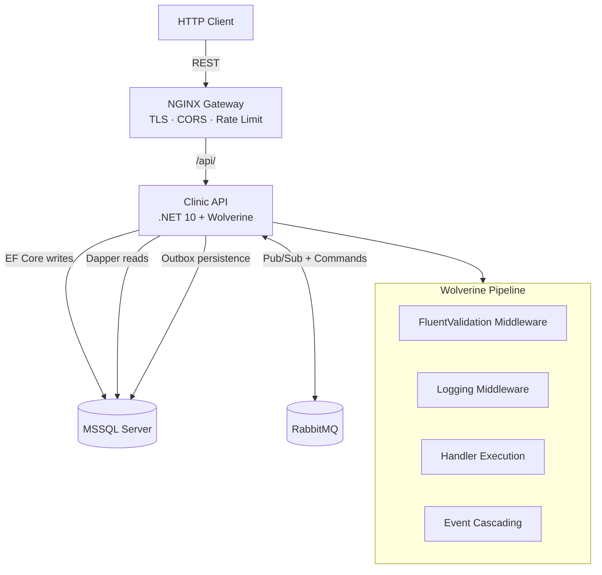
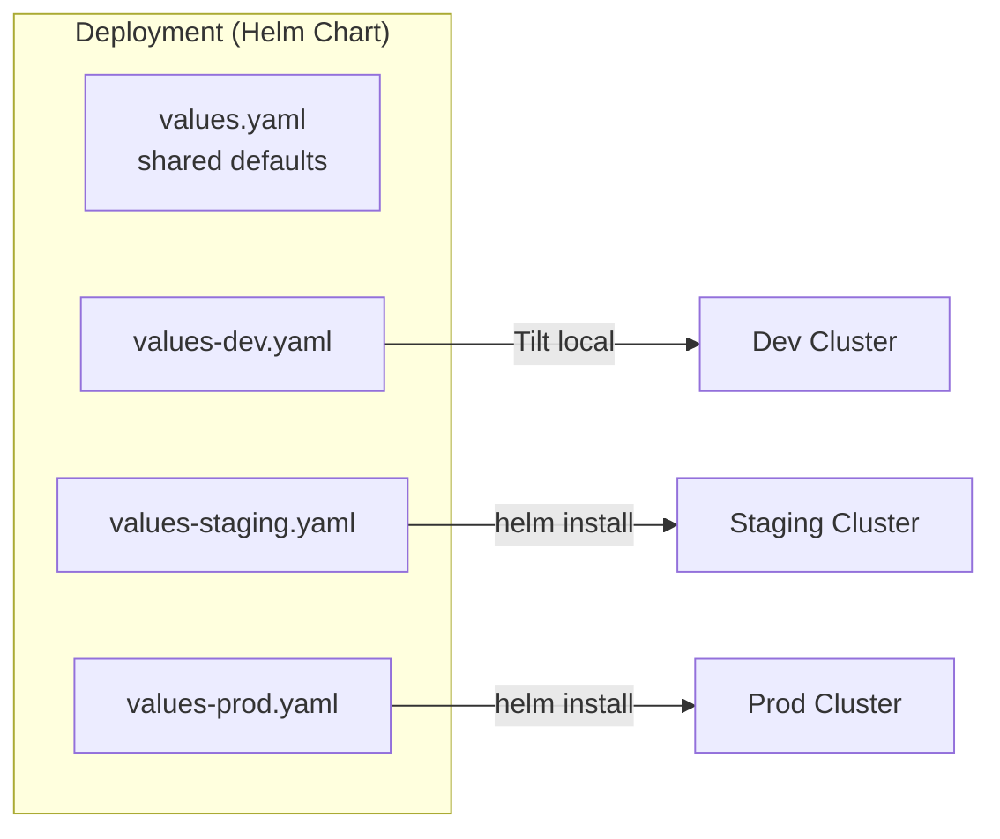
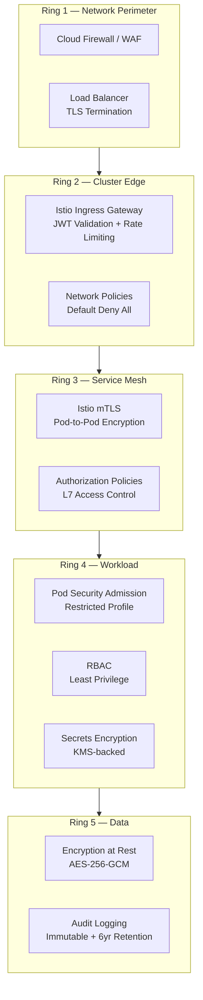

# CQRS .NET Example API with Wolverine

> An exhaustive example of a .NET 10 API using the mediator/CQRS pattern with [WolverineFx](https://wolverinefx.net), demonstrating all major patterns in a Healthcare/Clinic domain.

## Architecture







## Features Demonstrated

| Pattern | Implementation | Location |
|---------|---------------|----------|
| **Command/Query (CQRS)** | CreatePatient, ListPatients, GetPatientById | `Features/Patients/` |
| **HTTP Endpoints** | WolverineFx.Http with route attributes | `Features/*/Endpoints/` |
| **FluentValidation Middleware** | Auto-validated commands | `Features/*/Validators/` |
| **RabbitMQ Pub/Sub** | Topic exchange, event routing | `Infrastructure/Messaging/` |
| **Transactional Outbox** | SQL Server durable messaging | `Program.cs` config |
| **Saga Orchestration** | Appointment scheduling, Payment processing | `Features/Appointments/Saga/` |
| **Scheduled Messages** | Prescription refill reminders | `Features/Prescriptions/` |
| **Dead Letter Queue** | Retry policies + DLQ routing | `Program.cs` + RabbitMQ config |
| **Circuit Breaker** | Per-endpoint failure protection | `Program.cs` |
| **Batch Insert (EF Core)** | AddRange + chunking (500 rows) | `Features/Patients/BatchOperations/` |
| **Batch Insert (SqlBulkCopy)** | High-volume bulk (10k+ rows) | `Features/Patients/BatchOperations/` |
| **Batch Update (ExecuteUpdate)** | Set-based update without loading | `Features/Patients/BatchOperations/` |
| **Batch Update (Dapper)** | Parameterized bulk operations | `Features/Patients/BatchOperations/` |
| **Batch Delete (ExecuteDelete)** | Set-based delete without loading | `Features/Patients/BatchOperations/` |
| **Batch Message Processing** | Wolverine `T[]` handler batching | `Infrastructure/Messaging/` |
| **Custom Middleware** | Logging, performance tracking | `Infrastructure/Middleware/` |

## Prerequisites

- [.NET 10 SDK](https://dotnet.microsoft.com/download/dotnet/10.0)
- [Docker](https://docs.docker.com/get-docker/)
- [Tilt](https://tilt.dev/) (for local orchestration)
- [Helm 3](https://helm.sh/docs/intro/install/) (chart rendering and deployment)
- [kubectl](https://kubernetes.io/docs/tasks/tools/) (for k8s cluster interaction)

## Quick Start

```bash
# Clone and enter the project
cd cqrs-dotnet-example-api

# Start all services (MSSQL, RabbitMQ, API) via Helm + Tilt
tilt up

# Or build and run tests without Tilt
dotnet build
dotnet test tests/ClinicApi.Unit --filter "Category=Unit"
```

## Project Structure

```
cqrs-dotnet-example-api/
├── src/ClinicApi/                    # Main API project
│   ├── Program.cs                   # Wolverine + EF Core + RabbitMQ bootstrap
│   ├── Domain/                      # Entities, Value Objects, Events
│   ├── Features/                    # Vertical slices by domain
│   │   ├── Patients/                # CRUD + batch operations
│   │   ├── Appointments/            # Saga workflow
│   │   ├── Billing/                 # Payment saga + batch invoicing
│   │   └── Prescriptions/           # Scheduled messages
│   └── Infrastructure/              # Cross-cutting concerns
│       ├── Persistence/             # DbContext, Dapper, BulkInsert
│       ├── Messaging/               # Batch handlers, RabbitMQ config
│       └── Middleware/              # Logging, Performance
├── tests/
│   ├── ClinicApi.Unit/              # xUnit + NSubstitute + InMemory EF
│   ├── ClinicApi.Integration/       # Alba + Testcontainers + Respawn
│   └── ClinicApi.Performance/       # NBomber + BenchmarkDotNet
├── helm/clinic-api/                 # Helm chart (single source of k8s manifests)
│   ├── Chart.yaml
│   ├── values.yaml                  # Shared defaults
│   ├── values-dev.yaml              # Dev: ephemeral, self-signed TLS, Tilt
│   ├── values-staging.yaml          # Staging: cert-manager, persistent, 2 replicas
│   ├── values-prod.yaml             # Prod: HA, managed services, strict CORS
│   └── templates/                   # Templated k8s resources
├── docker/                          # Dockerfiles and infra config
├── docs/
│   └── testing-architecture.md      # Comprehensive testing guide
├── Tiltfile                         # Tilt orchestration (uses helm chart)
└── Makefile                         # Common development commands
```

## Helm Chart

The Helm chart at `helm/clinic-api/` is the **single source of truth** for all Kubernetes manifests. Tilt uses it for local dev, and `helm install` deploys to staging/prod.

### Environment Strategy

| Concern | Dev | Staging | Prod |
|---------|-----|---------|------|
| Replicas (API/NGINX) | 1 / 1 | 2 / 2 | 3 / 3 |
| MSSQL | In-cluster, ephemeral | In-cluster, persistent PVC | Managed (Azure SQL / RDS) |
| RabbitMQ | In-cluster, ephemeral | In-cluster, persistent PVC | Managed (CloudAMQP / Amazon MQ) |
| TLS | Self-signed | cert-manager (Let's Encrypt staging) | cert-manager (Let's Encrypt prod) |
| CORS origins | localhost | staging.example.com | app.example.com |
| RabbitMQ Management UI | Exposed | Exposed | Blocked |
| Secrets | Created by Helm (inline values) | External Secrets / sealed-secrets | External Secrets / sealed-secrets |
| DB Migration | Manual trigger (Tilt) | Helm post-upgrade hook | Helm post-upgrade hook |

### Deploying

```bash
# Dev (via Tilt — preferred for local development)
tilt up

# Staging
helm upgrade --install clinic-api ./helm/clinic-api \
  -f ./helm/clinic-api/values-staging.yaml \
  -n clinic-api-staging --create-namespace

# Production
helm upgrade --install clinic-api ./helm/clinic-api \
  -f ./helm/clinic-api/values-prod.yaml \
  -n clinic-api-prod --create-namespace
```

## Security Rings (Defense in Depth)

Five concentric security rings protect the system from network perimeter to data layer. Each ring is independently toggled per environment.

| Ring | Concern | Dev | Staging | Prod |
|------|---------|-----|---------|------|
| **1 — Network Perimeter** | Cloud WAF, LB + TLS termination | Off | WAF ACL attached | WAF + SSL cert on LB |
| **2 — Cluster Edge** | Istio Gateway + JWT, NetworkPolicies | Off | Default-deny + explicit allow, JWT validation | Same as staging |
| **3 — Service Mesh** | mTLS pod-to-pod, AuthorizationPolicies | Off | PERMISSIVE mTLS (migration-safe) | STRICT mTLS enforced |
| **4 — Workload** | Pod Security Admission, RBAC, KMS secrets | RBAC only (warn PSA) | Baseline PSA enforced, KMS | Restricted PSA enforced, KMS |
| **5 — Data** | Encryption at rest (TDE), Audit logging | Off | TDE + 1yr audit retention | TDE + 6yr immutable audit |

### Ring Resources by Environment

| Resource | Template | Dev | Staging | Prod |
|----------|----------|:---:|:-------:|:----:|
| WAF annotations on LB Service | `nginx.yaml` | — | ✓ | ✓ |
| Istio Gateway + VirtualService | `ring2-istio-gateway.yaml` | — | ✓ | ✓ |
| JWT RequestAuthentication | `ring2-istio-gateway.yaml` | — | ✓ | ✓ |
| NetworkPolicy (default deny + allow rules) | `ring2-network-policies.yaml` | — | ✓ | ✓ |
| PeerAuthentication (mTLS) | `ring3-service-mesh.yaml` | — | PERMISSIVE | STRICT |
| AuthorizationPolicy (L7) | `ring3-service-mesh.yaml` | — | ✓ | ✓ |
| Pod Security Admission labels | `namespace.yaml` | warn/baseline | enforce/baseline | enforce/restricted |
| ServiceAccount + Role + RoleBinding | `ring4-workload.yaml` | ✓ | ✓ | ✓ |
| Hardened securityContext on pods | `clinic-api.yaml` | ✓ | ✓ | ✓ |

### Prerequisites for Ring 2–3 (Istio)

Staging and production clusters require Istio installed:
```bash
istioctl install --set profile=default
kubectl label namespace clinic-api-staging istio-injection=enabled
kubectl label namespace clinic-api-prod istio-injection=enabled
```

## Development Commands

```bash
make up                  # Start all via Tilt
make down                # Stop all
make build               # Build solution
make test                # Run all tests
make test-unit           # Run unit tests only (<5s)
make test-integration    # Run integration tests (requires Docker)
make test-performance    # Run load tests (requires running API)
make migrate             # Apply EF Core migrations
make docker-build        # Build Docker image locally
make health              # Check API health endpoint
make rabbitmq-ui         # Open RabbitMQ management (localhost:15672)
make helm-lint           # Lint chart against all environment values
make helm-template-dev   # Dry-run render (dev)
make helm-template-staging # Dry-run render (staging)
make helm-template-prod  # Dry-run render (prod)
make helm-install-dev    # Install chart to current cluster (dev)
make helm-install-staging # Install to staging namespace
make helm-install-prod   # Install to prod (with confirmation gate)
```

## Testing

See [docs/testing-architecture.md](docs/testing-architecture.md) for comprehensive documentation including:
- Architecture diagrams and flow charts
- Step-by-step walkthroughs for adding each test type
- Decision matrix for choosing test types
- Troubleshooting guide

## Development Lifecycle

See [docs/development-lifecycle.md](docs/development-lifecycle.md) for the complete guide including:
- Adding a new endpoint (10-step walkthrough with code examples)
- Updating an existing endpoint (backward-compatible changes)
- Testing strategy (unit vs integration vs performance)
- Deployment workflows (local, staging, production, hotfix)
- Dev-to-release lifecycle (phase gates, CI pipeline, promotion flow)

## Domain Model

The Healthcare/Clinic domain includes:
- **Patients** — CRUD, batch import, insurance verification
- **Appointments** — Multi-step scheduling saga with timeout compensation
- **Billing** — Invoice management, payment processing saga, batch invoicing
- **Prescriptions** — Scheduled refill reminders, expiration warnings

## Future: GraphQL

Query models (`*Dto` records) are designed for GraphQL consumption. The read-side uses Dapper for performance, returning flat DTOs that map cleanly to GraphQL types.
