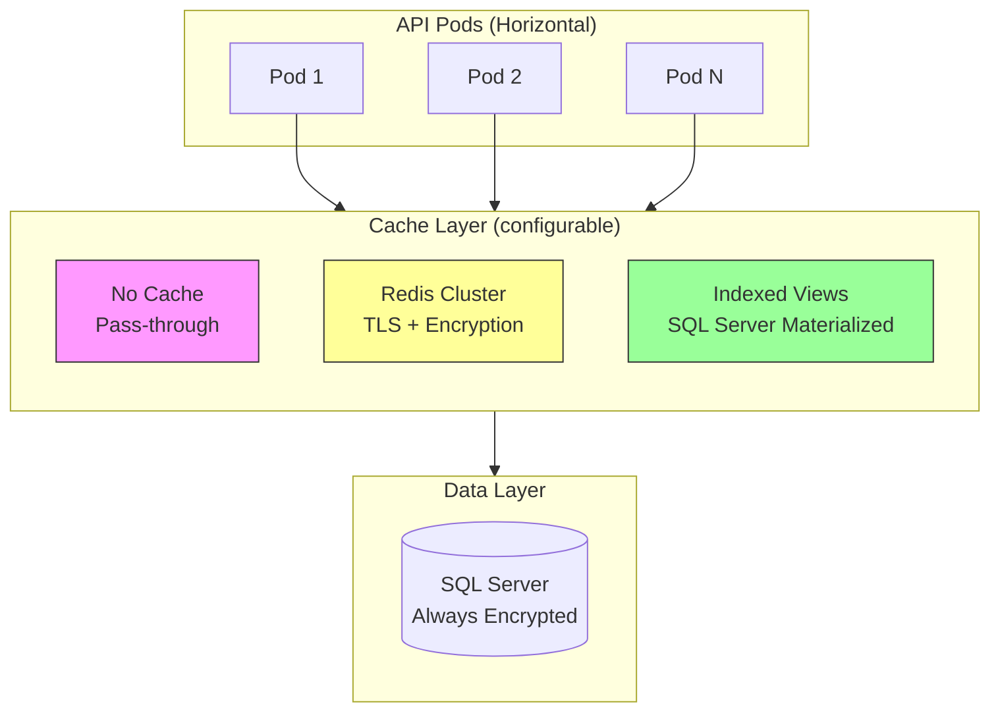
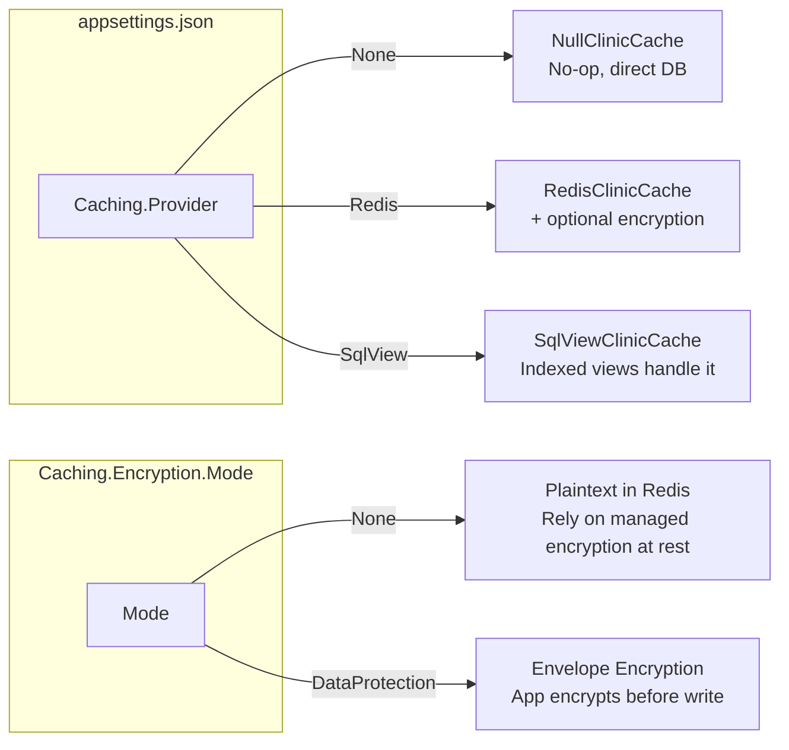
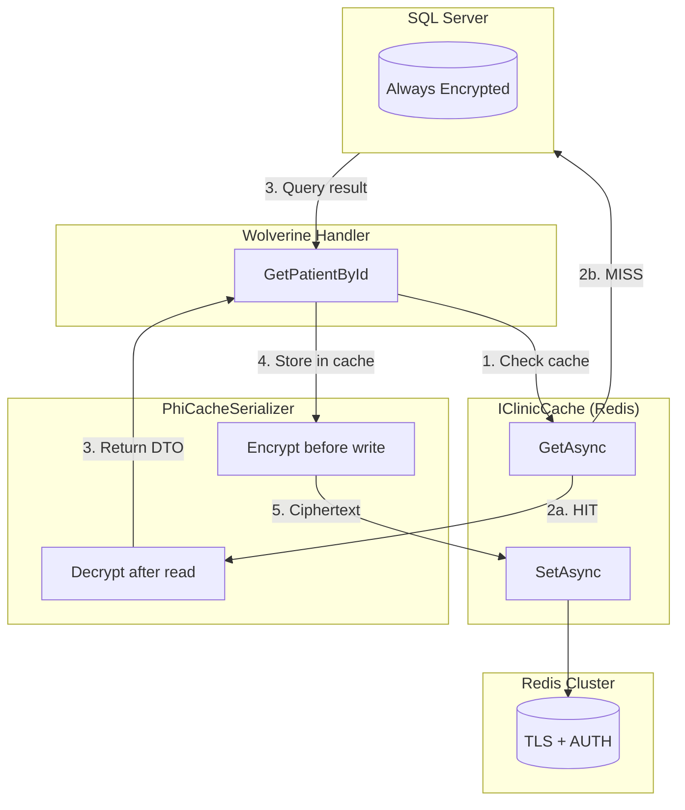
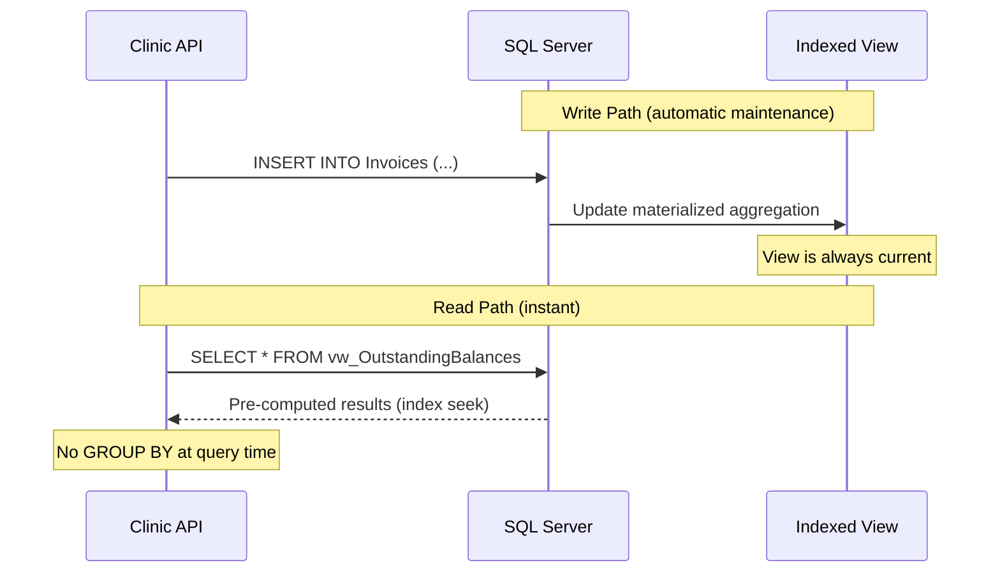
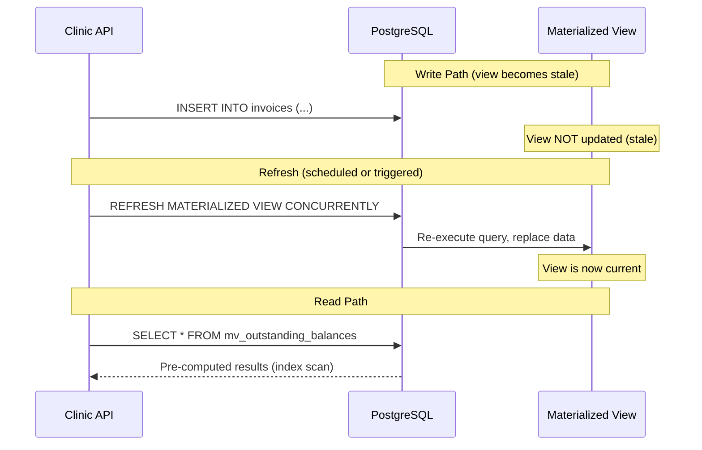
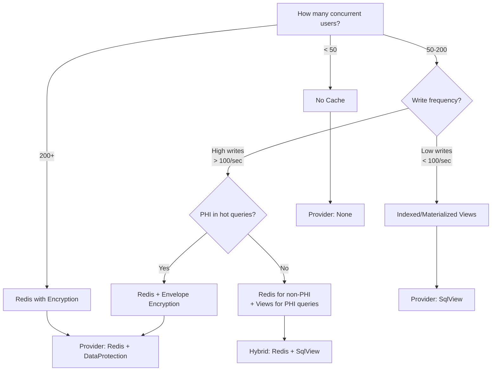

# Caching Architecture & HIPAA Compliance

> Comprehensive guide to caching strategies for the Clinic API, covering provider options, PHI protection, horizontal scaling, and database-level materialization for both SQL Server and PostgreSQL.

## Table of Contents

- [Architecture Overview](#architecture-overview)
- [HIPAA Requirements for Cached PHI](#hipaa-requirements-for-cached-phi)
- [Provider Options](#provider-options)
- [Option 1: No Cache (Pass-Through)](#option-1-no-cache-pass-through)
- [Option 2: Redis with PHI Protection](#option-2-redis-with-phi-protection)
- [Option 3: Indexed Views (SQL Server)](#option-3-indexed-views-sql-server)
- [Option 3b: Materialized Views (PostgreSQL)](#option-3b-materialized-views-postgresql)
- [Scaling Recommendations](#scaling-recommendations)
- [Configuration Reference](#configuration-reference)
- [Implementation Examples](#implementation-examples)

---

## Architecture Overview



The caching layer is pluggable — a single configuration value selects the active provider. All three options are self-contained and can be swapped without code changes.



---

## HIPAA Requirements for Cached PHI

Any system that stores, processes, or transmits electronic Protected Health Information (ePHI) must satisfy the HIPAA Security Rule technical safeguards. Caching introduces a **second data store** — all requirements that apply to the primary database also apply to the cache.

### Technical Safeguards Mapping (§164.312)

| HIPAA Requirement | Section | Cache Obligation | How We Satisfy |
|-------------------|---------|------------------|----------------|
| **Access Control** | §164.312(a)(1) | Only authorized users/services can read cached PHI | Redis ACLs (Redis 6+), network policies, mTLS between pods and Redis |
| **Audit Controls** | §164.312(b) | Record who accessed cached PHI and when | Audit logging at handler level (fires regardless of cache hit/miss) |
| **Integrity Controls** | §164.312(c)(1) | Cached data must not be altered in unauthorized ways | Short TTLs, write-through invalidation, Redis AUTH |
| **Transmission Security** | §164.312(e)(1) | PHI in transit to/from cache must be encrypted | Redis TLS required (non-negotiable for PHI) |
| **Encryption at Rest** | §164.312(a)(2)(iv) | PHI stored in cache must be encrypted at rest | Option A: Managed Redis encryption (Azure Enterprise) or Option B: App-level envelope encryption |
| **Automatic Logoff** | §164.312(a)(2)(iii) | Cached PHI must not persist indefinitely | Mandatory TTL on all PHI cache keys (max 5 minutes) |
| **Emergency Access** | §164.312(a)(2)(ii) | Cache failure must not block access to PHI | Cache is read-through — miss falls through to DB |

### PHI Classification for Caching

| Data | Contains PHI? | Cache Freely? | Requirements if Cached |
|------|:---:|:---:|---|
| Patient names, email, phone, address | ✅ | ❌ | Encryption at rest + TLS + TTL ≤ 5 min + audit |
| Patient DateOfBirth | ✅ | ❌ | Same as above (DOB is PHI per HHS guidance) |
| Appointment notes | ✅ | ❌ | Same — clinical content |
| Prescription notes | ✅ | ❌ | Same — clinical content |
| Invoice amounts, statuses | ❌ | ✅ | No PHI — standard cache rules |
| Aggregate counts (patient count by status) | ❌ | ✅ | De-identified — no restrictions |
| Insurance policy numbers | ✅ | ❌ | Full encryption + audit required |

### Minimum Viable Compliance Checklist

Before enabling Redis caching with PHI:

- [ ] Redis TLS enabled (reject plaintext connections)
- [ ] Redis AUTH with strong password or ACL-based access
- [ ] Encryption at rest confirmed (managed service or app-level)
- [ ] Redis included in BAA with cloud provider
- [ ] PHI TTL ≤ 5 minutes configured
- [ ] Audit logging verified end-to-end (cache hit path still logs)
- [ ] Network policy restricts Redis access to clinic-api pods only
- [ ] Redis backups (RDB/AOF) encrypted and retention-managed
- [ ] Penetration test covers Redis attack surface
- [ ] Incident response plan updated to include cache compromise scenario

### Risk Assessment: Cache Compromise

| Scenario | Impact without App Encryption | Impact with App Envelope Encryption |
|----------|------|------|
| Redis memory dump exfiltrated | PHI exposed in plaintext | Ciphertext only — useless without Data Protection keys |
| Redis backup (RDB) stolen | PHI exposed | Ciphertext only |
| Network sniffing between pod and Redis | PHI exposed if TLS disabled | Ciphertext (double protection: TLS + envelope) |
| Redis ACL bypass | Full read access to PHI | Ciphertext only |

**Recommendation:** Use app-level envelope encryption (`DataProtection` mode) for defense-in-depth. Even if managed Redis encryption fails or is misconfigured, PHI remains protected.

---

## Provider Options

### Decision Matrix

| Concurrent Users | Write Frequency | Best Provider | Why |
|:---:|---|---|---|
| < 50 | Any | `None` or `SqlView` | DB handles the load; views reduce CPU for aggregations |
| 50–200 | Low writes, heavy reads | `SqlView` | Pre-computed aggregates, zero infrastructure |
| 50–200 | High writes | `Redis` (non-PHI only) | Views get expensive to maintain under write load |
| 200+ | Any | `Redis` (full, with encryption) | SQL Server connection pressure, sub-ms reads needed |

---

## Option 1: No Cache (Pass-Through)

The default for development and small deployments. Every request hits SQL Server directly.

### When to Use

- Local development (simplicity, always-fresh data)
- Single API instance with < 50 concurrent users
- When debugging data freshness issues

### Configuration

```json
{
  "Caching": {
    "Provider": "None"
  }
}
```

### Behavior

- `IClinicCache.GetAsync()` always returns `null`
- `IClinicCache.SetAsync()` is a no-op
- `IClinicCache.InvalidateAsync()` is a no-op
- Zero overhead — handlers hit DB directly as they do today

---

## Option 2: Redis with PHI Protection

Distributed cache using Redis with configurable encryption for PHI data. Supports two encryption modes: managed (rely on Azure/AWS encryption at rest) or app-level envelope encryption.

### When to Use

- Multiple API pods (horizontal scaling)
- 200+ concurrent users
- Sub-millisecond read latency required
- Dashboard/list endpoints under heavy load

### Architecture



### Configuration

```json
{
  "Caching": {
    "Provider": "Redis",
    "Redis": {
      "ConnectionString": "clinic-redis:6380,ssl=true,abortConnect=false,password=...",
      "InstanceName": "clinic:",
      "DefaultTtlSeconds": 300,
      "PhiTtlSeconds": 120
    },
    "Encryption": {
      "Mode": "DataProtection",
      "DataProtectionPurpose": "ClinicApi.PhiCache.v1"
    }
  }
}
```

### Encryption Mode: `None` (Managed Redis Encryption)

Relies on the managed Redis service for encryption at rest. Appropriate when:

- Using Azure Cache for Redis Premium/Enterprise (AES-256 at rest by default)
- Using AWS ElastiCache with encryption-at-rest enabled
- The Redis service is covered by your BAA

```json
{
  "Caching": {
    "Provider": "Redis",
    "Encryption": {
      "Mode": "None"
    }
  }
}
```

Data flows: `Handler → Serialize (JSON) → Redis (TLS) → Stored (encrypted by platform)`

### Encryption Mode: `DataProtection` (App-Level Envelope Encryption)

The application encrypts PHI before writing to Redis using ASP.NET Data Protection. Even if Redis is compromised, cached data is unreadable without the key ring.

```json
{
  "Caching": {
    "Provider": "Redis",
    "Encryption": {
      "Mode": "DataProtection",
      "DataProtectionPurpose": "ClinicApi.PhiCache.v1"
    }
  }
}
```

Data flows: `Handler → Serialize (JSON) → Encrypt (AES-256-GCM via DataProtection) → Redis (TLS) → Stored (double-encrypted)`

### C# Implementation: Envelope Encryption Serializer

```csharp
using Microsoft.AspNetCore.DataProtection;

namespace ClinicApi.Infrastructure.Caching;

/// <summary>
/// Wraps serialization with ASP.NET Data Protection envelope encryption.
/// PHI is encrypted before being stored in Redis and decrypted on retrieval.
/// Key rotation is handled automatically by the Data Protection subsystem.
/// </summary>
public sealed class PhiCacheSerializer
{
    private readonly IDataProtector _protector;

    public PhiCacheSerializer(IDataProtectionProvider provider, CachingOptions options)
    {
        _protector = provider.CreateProtector(
            options.Encryption.DataProtectionPurpose ?? "ClinicApi.PhiCache.v1");
    }

    public byte[] Protect(byte[] plaintext)
    {
        return _protector.Protect(plaintext);
    }

    public byte[] Unprotect(byte[] ciphertext)
    {
        return _protector.Unprotect(ciphertext);
    }
}
```

### C# Implementation: Redis Cache with PHI Awareness

```csharp
using System.Text.Json;
using Microsoft.Extensions.Caching.Distributed;

namespace ClinicApi.Infrastructure.Caching;

/// <summary>
/// Redis-backed cache that optionally applies envelope encryption for PHI data.
/// Non-PHI data (aggregates, counts) bypasses encryption for performance.
/// </summary>
public sealed class RedisClinicCache : IClinicCache
{
    private readonly IDistributedCache _cache;
    private readonly PhiCacheSerializer? _serializer;
    private readonly CachingOptions _options;
    private readonly ILogger<RedisClinicCache> _logger;

    public RedisClinicCache(
        IDistributedCache cache,
        CachingOptions options,
        ILogger<RedisClinicCache> logger,
        PhiCacheSerializer? serializer = null)
    {
        _cache = cache;
        _options = options;
        _logger = logger;
        _serializer = serializer;
    }

    public async Task<T?> GetAsync<T>(string key, bool containsPhi = false,
        CancellationToken ct = default) where T : class
    {
        var bytes = await _cache.GetAsync(key, ct);
        if (bytes is null) return null;

        if (containsPhi && _serializer is not null)
            bytes = _serializer.Unprotect(bytes);

        return JsonSerializer.Deserialize<T>(bytes);
    }

    public async Task SetAsync<T>(string key, T value, bool containsPhi = false,
        CancellationToken ct = default) where T : class
    {
        var ttl = containsPhi
            ? TimeSpan.FromSeconds(_options.Redis.PhiTtlSeconds)
            : TimeSpan.FromSeconds(_options.Redis.DefaultTtlSeconds);

        var bytes = JsonSerializer.SerializeToUtf8Bytes(value);

        if (containsPhi && _serializer is not null)
            bytes = _serializer.Protect(bytes);

        await _cache.SetAsync(key, bytes, new DistributedCacheEntryOptions
        {
            AbsoluteExpirationRelativeToNow = ttl
        }, ct);
    }

    public async Task InvalidateAsync(string key, CancellationToken ct = default)
    {
        await _cache.RemoveAsync(key, ct);
    }

    public async Task InvalidateByPrefixAsync(string prefix, CancellationToken ct = default)
    {
        // Note: requires Redis SCAN — not available via IDistributedCache.
        // Production implementation uses StackExchange.Redis IConnectionMultiplexer directly.
        _logger.LogDebug("Prefix invalidation requested for {Prefix}", prefix);
    }
}
```

### C# Implementation: Handler Usage Example

```csharp
/// <summary>
/// GetPatientById with cache-aside pattern.
/// PhiAuditMiddleware fires on handler invocation regardless of cache hit/miss.
/// </summary>
public static class GetPatientByIdHandler
{
    public static async Task<PatientDto?> Handle(
        GetPatientById query,
        IClinicCache cache,
        IDbConnectionFactory connectionFactory)
    {
        var key = $"patient:{query.Id}";

        // 1. Check cache (PHI flag enables decryption)
        var cached = await cache.GetAsync<PatientDto>(key, containsPhi: true);
        if (cached is not null)
            return cached;

        // 2. Cache miss — query database
        const string sql = """
            SELECT Id, FirstName, LastName, DateOfBirth, Email, PhoneNumber,
                   CASE Status WHEN 0 THEN 'Active' /* ... */ END AS Status,
                   AddressCity AS City, AddressState AS State,
                   CreatedAt, UpdatedAt
            FROM Patients WHERE Id = @Id
            """;

        using var connection = connectionFactory.CreateConnection();
        var raw = await connection.QuerySingleOrDefaultAsync<PatientRawDto>(sql, new { query.Id });
        if (raw is null) return null;

        var dto = raw.ToDto();

        // 3. Populate cache (PHI flag enables encryption)
        await cache.SetAsync(key, dto, containsPhi: true);

        return dto;
    }
}
```

### TTL Strategy

| Cache Key Pattern | Contains PHI | TTL | Rationale |
|---|:---:|---|---|
| `patient:{id}` | ✅ | 2 min | Frequently accessed during a visit |
| `patient:list:page:{n}` | ✅ | 30 sec | High churn, names visible |
| `billing:outstanding` | ✅ | 2 min | Contains patient names |
| `billing:invoice:{id}` | ❌ | 5 min | Amounts only, no PHI |
| `stats:patient-count` | ❌ | 10 min | De-identified aggregate |
| `stats:revenue-mtd` | ❌ | 10 min | De-identified aggregate |

### Cache Invalidation

```csharp
// After any patient mutation (create, update, deactivate):
public static class CreatePatientHandler
{
    public static async Task<PatientCreated> Handle(
        CreatePatient command,
        ClinicDbContext db,
        IClinicCache cache)
    {
        var patient = new Patient { /* ... */ };
        db.Patients.Add(patient);
        await db.SaveChangesAsync();

        // Invalidate related cache entries
        await cache.InvalidateByPrefixAsync("patient:list:");
        await cache.InvalidateAsync("stats:patient-count");

        return new PatientCreated(patient.Id, patient.Email);
    }
}
```

---

## Option 3: Indexed Views (SQL Server)

Indexed (materialized) views pre-compute expensive aggregation queries at write time. SQL Server maintains the view automatically — no cache invalidation logic, no separate infrastructure.

### When to Use

- Expensive GROUP BY + JOIN queries that run frequently
- Data freshness must be real-time (views update with every write)
- You want to avoid introducing a new infrastructure dependency
- PHI stays exclusively in SQL Server (simplest HIPAA compliance)
- Write volume is moderate (< 1000 writes/sec to participating tables)

### How It Works



### Constraints (SQL Server Enforces These)

| Constraint | Reason | Impact |
|---|---|---|
| `WITH SCHEMABINDING` required | Prevents underlying table changes from silently breaking the view | Must update view when altering base tables |
| No `OUTER JOIN` | SQL Server cannot incrementally maintain outer join aggregates | Use INNER JOIN only |
| No subqueries | Same reason — non-incremental | Flatten into JOINs |
| Must include `COUNT_BIG(*)` | Required for any aggregation | Add to SELECT |
| All GROUP BY columns must be in SELECT | Uniqueness requirement for clustered index | Include all grouping columns |
| No `DISTINCT`, `TOP`, `UNION` | Non-incremental operations | Restructure query |
| Deterministic functions only | `GETDATE()`, `NEWID()` break incrementality | Use column values only |
| No `APPLY`, `EXCEPT`, `INTERSECT` | Not supported in indexed views | Restructure |

### Example 1: Outstanding Balances (Replaces Heavy Aggregation Query)

**Current query (runs on every request):**

```sql
-- This executes GROUP BY + SUM + JOIN on every call to GET /api/billing/outstanding
SELECT p.Id AS PatientId,
       p.FirstName + ' ' + p.LastName AS PatientName,
       SUM(i.Amount - i.PaidAmount) AS TotalOutstanding,
       COUNT(i.Id) AS InvoiceCount
FROM Patients p
INNER JOIN Invoices i ON p.Id = i.PatientId
WHERE i.Status IN (1, 3, 4)  -- Issued, Overdue, PartiallyPaid
GROUP BY p.Id, p.FirstName, p.LastName
HAVING SUM(i.Amount - i.PaidAmount) >= @MinimumBalance
ORDER BY TotalOutstanding DESC
```

**Indexed view replacement:**

```sql
-- Create the materialized view
CREATE VIEW dbo.vw_OutstandingBalances
WITH SCHEMABINDING
AS
SELECT
    p.Id AS PatientId,
    p.FirstName,
    p.LastName,
    COUNT_BIG(*) AS InvoiceCount,
    SUM(i.Amount) AS TotalAmount,
    SUM(i.PaidAmount) AS TotalPaidAmount,
    SUM(i.Amount - i.PaidAmount) AS TotalOutstanding
FROM dbo.Patients p
INNER JOIN dbo.Invoices i ON p.Id = i.PatientId
WHERE i.Status IN (1, 3, 4)
GROUP BY p.Id, p.FirstName, p.LastName;
GO

-- Materialize with a unique clustered index
CREATE UNIQUE CLUSTERED INDEX IX_UCL_vw_OutstandingBalances
ON dbo.vw_OutstandingBalances (PatientId);
GO

-- Non-clustered for sorting by balance (covers the dashboard sort)
CREATE NONCLUSTERED INDEX IX_NC_vw_OutstandingBalances_TotalOutstanding
ON dbo.vw_OutstandingBalances (TotalOutstanding DESC)
INCLUDE (FirstName, LastName, InvoiceCount);
GO
```

**Simplified handler query:**

```sql
-- Reads from pre-computed index — no GROUP BY, no JOIN at query time
SELECT PatientId, FirstName, LastName, TotalOutstanding, InvoiceCount
FROM dbo.vw_OutstandingBalances WITH (NOEXPAND)
WHERE TotalOutstanding >= @MinimumBalance
ORDER BY TotalOutstanding DESC
OFFSET @Offset ROWS FETCH NEXT @PageSize ROWS ONLY;
```

**C# handler using the view:**

```csharp
public static class GetOutstandingBalancesHandler
{
    public static async Task<OutstandingBalancesResponse> Handle(
        GetOutstandingBalances query,
        IDbConnectionFactory connectionFactory)
    {
        const string sql = """
            SELECT PatientId,
                   FirstName + ' ' + LastName AS PatientName,
                   CAST(TotalOutstanding AS decimal(18,2)) AS TotalOutstanding,
                   CAST(InvoiceCount AS int) AS InvoiceCount
            FROM dbo.vw_OutstandingBalances WITH (NOEXPAND)
            WHERE TotalOutstanding >= @MinimumBalance
            ORDER BY TotalOutstanding DESC
            OFFSET @Offset ROWS FETCH NEXT @PageSize ROWS ONLY
            """;

        using var connection = connectionFactory.CreateConnection();
        var items = (await connection.QueryAsync<OutstandingBalanceDto>(sql, new
        {
            query.MinimumBalance,
            Offset = (query.Page - 1) * query.PageSize,
            query.PageSize
        })).ToList();

        return new OutstandingBalancesResponse(items, query.Page, query.PageSize);
    }
}
```

### Example 2: Patient Count by Status (Dashboard Widget)

```sql
CREATE VIEW dbo.vw_PatientStatusCounts
WITH SCHEMABINDING
AS
SELECT
    Status,
    COUNT_BIG(*) AS PatientCount
FROM dbo.Patients
GROUP BY Status;
GO

CREATE UNIQUE CLUSTERED INDEX IX_UCL_vw_PatientStatusCounts
ON dbo.vw_PatientStatusCounts (Status);
GO
```

```sql
-- Dashboard query: instant, no table scan
SELECT
    CASE Status
        WHEN 0 THEN 'Active'
        WHEN 1 THEN 'Inactive'
        WHEN 2 THEN 'Deceased'
        WHEN 3 THEN 'Transferred'
    END AS StatusName,
    PatientCount
FROM dbo.vw_PatientStatusCounts WITH (NOEXPAND);
```

### Example 3: Monthly Revenue Summary

```sql
CREATE VIEW dbo.vw_MonthlyRevenue
WITH SCHEMABINDING
AS
SELECT
    YEAR(i.IssuedAt) AS IssueYear,
    MONTH(i.IssuedAt) AS IssueMonth,
    COUNT_BIG(*) AS InvoiceCount,
    SUM(i.Amount) AS TotalBilled,
    SUM(i.PaidAmount) AS TotalCollected
FROM dbo.Invoices i
WHERE i.Status != 5  -- Exclude Cancelled
GROUP BY YEAR(i.IssuedAt), MONTH(i.IssuedAt);
GO

CREATE UNIQUE CLUSTERED INDEX IX_UCL_vw_MonthlyRevenue
ON dbo.vw_MonthlyRevenue (IssueYear, IssueMonth);
GO
```

```sql
-- Last 12 months revenue: instant
SELECT IssueYear, IssueMonth, TotalBilled, TotalCollected,
       (TotalBilled - TotalCollected) AS Outstanding
FROM dbo.vw_MonthlyRevenue WITH (NOEXPAND)
WHERE IssueYear >= YEAR(DATEADD(MONTH, -12, GETDATE()))
ORDER BY IssueYear DESC, IssueMonth DESC;
```

### HIPAA Advantage of Indexed Views

| Concern | Indexed View | Redis |
|---------|:---:|:---:|
| PHI leaves the database | ❌ No | ✅ Yes |
| New BAA required | ❌ No | ✅ Yes |
| New encryption layer needed | ❌ No | ✅ Yes |
| New audit surface | ❌ No | ✅ Yes |
| New network attack surface | ❌ No | ✅ Yes |
| Compliance effort | Minimal | Significant |

### Write Overhead

Every INSERT/UPDATE/DELETE on `Invoices` or `Patients` triggers automatic view maintenance:

| Operation | Overhead | Mitigation |
|---|---|---|
| Single row INSERT | ~0.1ms additional | Negligible |
| Batch INSERT (1000 rows) | ~5-10ms additional | Acceptable |
| Bulk INSERT (10k+ rows) | 50-200ms additional | Consider disabling view during bulk loads |
| UPDATE on Amount/Status | ~0.1ms per row | Negligible |
| DELETE | ~0.1ms per row | Negligible |

**Rule of thumb:** If writes to the base tables exceed 1000/sec sustained, the view maintenance cost becomes measurable. At that point, consider Redis for read-heavy queries and reserve views for low-churn aggregations.

### Always Encrypted Compatibility

⚠️ **Important:** Indexed views that reference Always Encrypted columns with server-side operations (concatenation, LIKE, comparison) will fail in staging/prod where encryption is enabled.

| View Operation | Deterministic Encryption | Randomized Encryption |
|---|:---:|:---:|
| Column in GROUP BY | ✅ Works | ❌ Fails |
| Column in WHERE (equality) | ✅ Works | ❌ Fails |
| Column in JOIN ON | ✅ Works | ❌ Fails |
| String concatenation (`+`) | ❌ Fails | ❌ Fails |
| SUM/AVG/COUNT on column | ❌ Fails | ❌ Fails |
| Column in SELECT (passthrough) | ✅ Works | ✅ Works |

**Impact on our views:**

- `vw_OutstandingBalances` uses `p.FirstName + ' ' + p.LastName` — this will fail when Always Encrypted is enabled on those columns. **Fix:** Select `FirstName` and `LastName` separately, concatenate client-side.
- `vw_MonthlyRevenue` uses `SUM(i.Amount)` — works because `Amount` is NOT an encrypted column.
- `vw_PatientStatusCounts` groups by `Status` — works because `Status` is NOT encrypted.

### Migration Script

```sql
-- EF Core migration: add indexed views
-- File: Infrastructure/Persistence/Migrations/YYYYMMDD_AddCachingIndexedViews.sql

-- Outstanding balances (most expensive query in the system)
IF NOT EXISTS (SELECT 1 FROM sys.views WHERE name = 'vw_OutstandingBalances')
BEGIN
    EXEC('
    CREATE VIEW dbo.vw_OutstandingBalances
    WITH SCHEMABINDING
    AS
    SELECT
        p.Id AS PatientId,
        p.FirstName,
        p.LastName,
        COUNT_BIG(*) AS InvoiceCount,
        SUM(i.Amount) AS TotalAmount,
        SUM(i.PaidAmount) AS TotalPaidAmount,
        SUM(i.Amount - i.PaidAmount) AS TotalOutstanding
    FROM dbo.Patients p
    INNER JOIN dbo.Invoices i ON p.Id = i.PatientId
    WHERE i.Status IN (1, 3, 4)
    GROUP BY p.Id, p.FirstName, p.LastName;
    ');

    CREATE UNIQUE CLUSTERED INDEX IX_UCL_vw_OutstandingBalances
    ON dbo.vw_OutstandingBalances (PatientId);

    CREATE NONCLUSTERED INDEX IX_NC_vw_OutstandingBalances_TotalOutstanding
    ON dbo.vw_OutstandingBalances (TotalOutstanding DESC)
    INCLUDE (FirstName, LastName, InvoiceCount);
END
GO

-- Patient status counts (dashboard)
IF NOT EXISTS (SELECT 1 FROM sys.views WHERE name = 'vw_PatientStatusCounts')
BEGIN
    EXEC('
    CREATE VIEW dbo.vw_PatientStatusCounts
    WITH SCHEMABINDING
    AS
    SELECT Status, COUNT_BIG(*) AS PatientCount
    FROM dbo.Patients
    GROUP BY Status;
    ');

    CREATE UNIQUE CLUSTERED INDEX IX_UCL_vw_PatientStatusCounts
    ON dbo.vw_PatientStatusCounts (Status);
END
GO
```

---

## Option 3b: Materialized Views (PostgreSQL)

PostgreSQL's materialized views serve the same purpose as SQL Server indexed views but with different mechanics. They are **snapshot-based** (refreshed on demand) rather than incrementally maintained.

### Key Differences from SQL Server

| Behavior | SQL Server Indexed View | PostgreSQL Materialized View |
|---|---|---|
| Update timing | Immediate (every write) | On demand (`REFRESH`) |
| Write overhead | Per-row maintenance cost | Zero until refresh |
| Data freshness | Always current | Stale between refreshes |
| Refresh locking | N/A (always current) | `CONCURRENTLY` avoids lock |
| Indexing | Standard indexes on view | Standard indexes on view |
| Schema binding | Required | Not required |
| Constraints | Many (no OUTER JOIN, etc.) | None — any query works |

### Architecture



### Example 1: Outstanding Balances

```sql
-- Create the materialized view (no restrictions on query complexity)
CREATE MATERIALIZED VIEW mv_outstanding_balances AS
SELECT
    p.id AS patient_id,
    p.first_name,
    p.last_name,
    p.first_name || ' ' || p.last_name AS patient_name,
    COUNT(*) AS invoice_count,
    SUM(i.amount) AS total_amount,
    SUM(i.paid_amount) AS total_paid,
    SUM(i.amount - i.paid_amount) AS total_outstanding,
    MAX(i.issued_at) AS last_invoice_date
FROM patients p
INNER JOIN invoices i ON p.id = i.patient_id
WHERE i.status IN ('issued', 'overdue', 'partially_paid')
GROUP BY p.id, p.first_name, p.last_name
HAVING SUM(i.amount - i.paid_amount) > 0
WITH DATA;

-- Add indexes for query patterns
CREATE UNIQUE INDEX idx_mv_outstanding_patient_id
ON mv_outstanding_balances (patient_id);

CREATE INDEX idx_mv_outstanding_total_desc
ON mv_outstanding_balances (total_outstanding DESC);

-- Composite for filtered + sorted pagination
CREATE INDEX idx_mv_outstanding_filtered
ON mv_outstanding_balances (total_outstanding DESC)
WHERE total_outstanding >= 100.00;
```

### Example 2: Patient Status Dashboard

```sql
CREATE MATERIALIZED VIEW mv_patient_status_counts AS
SELECT
    status,
    COUNT(*) AS patient_count,
    MIN(created_at) AS earliest_patient,
    MAX(created_at) AS latest_patient
FROM patients
GROUP BY status
WITH DATA;

CREATE UNIQUE INDEX idx_mv_patient_status
ON mv_patient_status_counts (status);
```

### Example 3: Monthly Revenue with Trends

```sql
-- PostgreSQL allows window functions, CTEs, anything in materialized views
CREATE MATERIALIZED VIEW mv_monthly_revenue AS
WITH monthly AS (
    SELECT
        DATE_TRUNC('month', issued_at) AS month,
        COUNT(*) AS invoice_count,
        SUM(amount) AS total_billed,
        SUM(paid_amount) AS total_collected,
        SUM(amount - paid_amount) AS outstanding
    FROM invoices
    WHERE status != 'cancelled'
    GROUP BY DATE_TRUNC('month', issued_at)
)
SELECT
    month,
    invoice_count,
    total_billed,
    total_collected,
    outstanding,
    -- Month-over-month growth
    LAG(total_billed) OVER (ORDER BY month) AS prev_month_billed,
    ROUND(
        (total_billed - LAG(total_billed) OVER (ORDER BY month))
        / NULLIF(LAG(total_billed) OVER (ORDER BY month), 0) * 100, 2
    ) AS growth_pct
FROM monthly
ORDER BY month DESC
WITH DATA;

CREATE UNIQUE INDEX idx_mv_monthly_revenue_month
ON mv_monthly_revenue (month DESC);
```

### Example 4: Provider Schedule Utilization

```sql
-- Complex query that would be expensive on every request
CREATE MATERIALIZED VIEW mv_provider_utilization AS
SELECT
    a.provider_name,
    DATE_TRUNC('week', a.scheduled_at) AS week_start,
    COUNT(*) AS total_appointments,
    COUNT(*) FILTER (WHERE a.status = 'completed') AS completed,
    COUNT(*) FILTER (WHERE a.status = 'cancelled') AS cancelled,
    COUNT(*) FILTER (WHERE a.status = 'no_show') AS no_shows,
    ROUND(
        COUNT(*) FILTER (WHERE a.status = 'completed')::numeric / NULLIF(COUNT(*), 0) * 100, 1
    ) AS completion_rate,
    AVG(EXTRACT(EPOCH FROM a.duration)) / 60 AS avg_duration_minutes
FROM appointments a
WHERE a.scheduled_at >= NOW() - INTERVAL '6 months'
GROUP BY a.provider_name, DATE_TRUNC('week', a.scheduled_at)
WITH DATA;

CREATE UNIQUE INDEX idx_mv_provider_util
ON mv_provider_utilization (provider_name, week_start DESC);

CREATE INDEX idx_mv_provider_util_week
ON mv_provider_utilization (week_start DESC);
```

### Refresh Strategies

#### Strategy 1: Scheduled (pg_cron)

Best for dashboards where 1-5 minute staleness is acceptable.

```sql
-- Install pg_cron extension (once)
CREATE EXTENSION IF NOT EXISTS pg_cron;

-- Refresh outstanding balances every 2 minutes
SELECT cron.schedule(
    'refresh_outstanding_balances',
    '*/2 * * * *',
    'REFRESH MATERIALIZED VIEW CONCURRENTLY mv_outstanding_balances'
);

-- Refresh status counts every 5 minutes
SELECT cron.schedule(
    'refresh_patient_status',
    '*/5 * * * *',
    'REFRESH MATERIALIZED VIEW CONCURRENTLY mv_patient_status_counts'
);

-- Refresh monthly revenue hourly (low churn)
SELECT cron.schedule(
    'refresh_monthly_revenue',
    '0 * * * *',
    'REFRESH MATERIALIZED VIEW CONCURRENTLY mv_monthly_revenue'
);

-- Check scheduled jobs
SELECT * FROM cron.job;
```

#### Strategy 2: Trigger-Based (Event-Driven)

Refresh immediately after relevant mutations. Best for small, fast views.

```sql
-- Function to refresh a view (with concurrency protection)
CREATE OR REPLACE FUNCTION refresh_mv_outstanding_balances()
RETURNS TRIGGER AS $$
BEGIN
    -- Use advisory lock to prevent concurrent refreshes
    IF pg_try_advisory_xact_lock(hashtext('mv_outstanding_balances')) THEN
        REFRESH MATERIALIZED VIEW CONCURRENTLY mv_outstanding_balances;
    END IF;
    RETURN NULL;
END;
$$ LANGUAGE plpgsql;

-- Trigger on invoice changes
CREATE TRIGGER trg_refresh_outstanding_on_invoice
AFTER INSERT OR UPDATE OR DELETE ON invoices
FOR EACH STATEMENT
EXECUTE FUNCTION refresh_mv_outstanding_balances();
```

⚠️ **Warning:** Trigger-based refresh adds latency to every write. Only use for small views (< 10k rows) that refresh in < 100ms.

#### Strategy 3: Application-Driven (Best for This Project)

Refresh from the application after relevant mutations. Gives full control over timing.

```csharp
/// <summary>
/// Refreshes PostgreSQL materialized views after mutations.
/// Called from command handlers that modify data feeding into views.
/// </summary>
public sealed class MaterializedViewRefresher
{
    private readonly IDbConnectionFactory _connectionFactory;
    private readonly ILogger<MaterializedViewRefresher> _logger;

    public MaterializedViewRefresher(
        IDbConnectionFactory connectionFactory,
        ILogger<MaterializedViewRefresher> logger)
    {
        _connectionFactory = connectionFactory;
        _logger = logger;
    }

    public async Task RefreshAsync(string viewName, CancellationToken ct = default)
    {
        // CONCURRENTLY allows reads during refresh (requires UNIQUE index)
        var sql = $"REFRESH MATERIALIZED VIEW CONCURRENTLY {viewName}";

        using var connection = _connectionFactory.CreateConnection();
        var sw = System.Diagnostics.Stopwatch.StartNew();

        await connection.ExecuteAsync(new CommandDefinition(sql, cancellationToken: ct));

        _logger.LogInformation(
            "Materialized view {ViewName} refreshed in {ElapsedMs}ms",
            viewName, sw.ElapsedMilliseconds);
    }
}

// Usage in a handler:
public static class CreateInvoiceHandler
{
    public static async Task<InvoiceCreated> Handle(
        CreateInvoice command,
        ClinicDbContext db,
        MaterializedViewRefresher viewRefresher)
    {
        // ... create invoice ...

        // Fire-and-forget refresh (or await if freshness is critical)
        _ = viewRefresher.RefreshAsync("mv_outstanding_balances");

        return new InvoiceCreated(invoice.Id);
    }
}
```

#### Strategy 4: Wolverine Cascaded Event (Recommended)

Use Wolverine's event cascading to refresh views asynchronously after mutations. Non-blocking, retry-safe.

```csharp
// Domain event signals a refresh is needed
public record RefreshMaterializedView(string ViewName);

// Handler listens to invoice events and cascades a refresh
public static class InvoiceCreatedHandler
{
    // Wolverine cascading: returning a message publishes it
    public static RefreshMaterializedView Handle(InvoiceCreated @event)
    {
        return new RefreshMaterializedView("mv_outstanding_balances");
    }
}

// Generic handler refreshes any materialized view
public static class RefreshMaterializedViewHandler
{
    public static async Task Handle(
        RefreshMaterializedView command,
        IDbConnectionFactory connectionFactory,
        ILogger logger)
    {
        var sql = $"REFRESH MATERIALIZED VIEW CONCURRENTLY {command.ViewName}";
        using var connection = connectionFactory.CreateConnection();
        await connection.ExecuteAsync(sql);

        logger.LogInformation("Refreshed materialized view {View}", command.ViewName);
    }
}
```

### CONCURRENTLY vs Standard Refresh

| Mode | Locking | Requires | Use When |
|---|---|---|---|
| `REFRESH MATERIALIZED VIEW mv_name` | Exclusive lock — blocks all reads during refresh | Nothing special | Small views (< 1k rows), maintenance windows |
| `REFRESH MATERIALIZED VIEW CONCURRENTLY mv_name` | No lock — reads continue against old data | At least one UNIQUE index on the view | Production, any view accessed by users |

**Always use `CONCURRENTLY` in production.** The tradeoff is slightly slower refresh (diff-based update) but no read blocking.

### Partial Refresh Pattern (Manual)

PostgreSQL doesn't support incremental/partial refresh natively. For very large views, use a partitioned approach:

```sql
-- Instead of one giant view, partition by time
CREATE MATERIALIZED VIEW mv_revenue_current_month AS
SELECT /* ... */
FROM invoices
WHERE issued_at >= DATE_TRUNC('month', NOW())
WITH DATA;

CREATE MATERIALIZED VIEW mv_revenue_historical AS
SELECT /* ... */
FROM invoices
WHERE issued_at < DATE_TRUNC('month', NOW())
WITH DATA;

-- Only refresh current month frequently (small dataset)
-- Historical view refreshed daily or on month boundary
```

### PostgreSQL Extensions for Real-Time Views

For scenarios requiring true real-time materialization (like SQL Server indexed views):

| Extension | Behavior | Production Ready |
|---|---|---|
| `pg_ivm` (Incremental View Maintenance) | Incrementally updates view on row changes | Experimental |
| `timescaledb` continuous aggregates | Auto-refresh with configurable lag | ✅ Production |
| `Citus` distributed materialized views | Distributed refresh across shards | ✅ Production |

```sql
-- TimescaleDB continuous aggregate (real-time materialization)
-- Requires timescaledb extension and hypertable
CREATE MATERIALIZED VIEW mv_hourly_appointments
WITH (timescaledb.continuous) AS
SELECT
    time_bucket('1 hour', scheduled_at) AS bucket,
    provider_name,
    COUNT(*) AS appointment_count
FROM appointments
GROUP BY bucket, provider_name
WITH DATA;

-- Auto-refresh policy
SELECT add_continuous_aggregate_policy('mv_hourly_appointments',
    start_offset => INTERVAL '1 day',
    end_offset => INTERVAL '1 hour',
    schedule_interval => INTERVAL '5 minutes'
);
```

### Monitoring View Freshness

```sql
-- Track when each view was last refreshed
CREATE TABLE mv_refresh_log (
    view_name TEXT PRIMARY KEY,
    last_refreshed TIMESTAMPTZ NOT NULL DEFAULT NOW(),
    duration_ms INTEGER,
    row_count BIGINT
);

-- Updated by the refresh function
CREATE OR REPLACE FUNCTION refresh_and_log(view_name TEXT)
RETURNS VOID AS $$
DECLARE
    start_time TIMESTAMPTZ := clock_timestamp();
    rows BIGINT;
BEGIN
    EXECUTE format('REFRESH MATERIALIZED VIEW CONCURRENTLY %I', view_name);
    EXECUTE format('SELECT COUNT(*) FROM %I', view_name) INTO rows;

    INSERT INTO mv_refresh_log (view_name, last_refreshed, duration_ms, row_count)
    VALUES (view_name, NOW(), EXTRACT(MILLISECOND FROM clock_timestamp() - start_time)::INT, rows)
    ON CONFLICT (view_name)
    DO UPDATE SET
        last_refreshed = EXCLUDED.last_refreshed,
        duration_ms = EXCLUDED.duration_ms,
        row_count = EXCLUDED.row_count;
END;
$$ LANGUAGE plpgsql;

-- Check freshness (alert if > 5 minutes stale)
SELECT view_name, last_refreshed,
       NOW() - last_refreshed AS staleness,
       duration_ms, row_count
FROM mv_refresh_log
WHERE NOW() - last_refreshed > INTERVAL '5 minutes';
```

### HIPAA Considerations for PostgreSQL

| Concern | PostgreSQL Approach |
|---|---|
| Encryption at rest | `pgcrypto` for column-level, or full-disk encryption (LUKS/dm-crypt), or managed (RDS/Cloud SQL encryption) |
| PHI in materialized views | Views containing PHI inherit the same encryption posture as base tables |
| Audit logging | `pgaudit` extension logs all view access |
| Access control | Row-Level Security (RLS) policies apply to base tables but NOT to materialized views — restrict view access via GRANT/REVOKE |
| Transmission security | `sslmode=require` in connection string |

⚠️ **Critical difference from SQL Server:** PostgreSQL does not have an Always Encrypted equivalent where the server never sees plaintext. All encryption/decryption happens at the server level or application level. For HIPAA with PostgreSQL, use application-level encryption for PHI columns + managed encryption at rest.

---

## Scaling Recommendations

### Horizontal Scaling Decision Tree



### Scaling Characteristics by Provider

| Dimension | No Cache | Indexed Views | Redis |
|---|---|---|---|
| Read latency (p50) | 5-50ms | 1-5ms | < 1ms |
| Read latency (p99) | 100-500ms | 5-20ms | 2-5ms |
| Max concurrent readers | ~100 (SQL connection limit) | ~200 (less CPU per read) | 100k+ |
| Horizontal pod scaling | Limited by DB connections | Limited by DB connections | Unlimited |
| Write overhead | None | Per-row view maintenance | Cache invalidation logic |
| Infrastructure cost | $0 additional | $0 additional | $50-500/mo (managed Redis) |
| HIPAA compliance effort | Already compliant | Already compliant | Significant (encryption, BAA, audit) |
| Freshness | Real-time | Real-time (SQL Server) / configurable (PostgreSQL) | TTL-based (stale window) |

### Connection Pool Pressure

The primary scaling bottleneck for SQL-only architectures:

```
Max connections = pods × pool_size_per_pod

Example:
  5 pods × 30 connections/pool = 150 concurrent DB connections
  SQL Server default max: 32,767 (but practical limit ~500 for performance)
  Azure SQL S3: ~200 concurrent workers
```

**Redis eliminates this pressure for reads:**
- Cache hit → no DB connection needed
- Cache miss → single connection for the query
- At 80% hit rate with 200 users: 200 × 0.2 = 40 DB reads instead of 200

### Recommended Architecture by Scale

#### Small (1-3 pods, < 50 users)

```json
{ "Caching": { "Provider": "None" } }
```

No caching infrastructure. Direct DB queries. Simple, compliant, debuggable.

#### Medium (3-5 pods, 50-200 users)

```json
{ "Caching": { "Provider": "SqlView" } }
```

Indexed views handle hot aggregation queries. No new infrastructure. PHI stays in SQL Server.

#### Large (5+ pods, 200+ users)

```json
{
  "Caching": {
    "Provider": "Redis",
    "Redis": {
      "ConnectionString": "clinic-redis:6380,ssl=true,password=...",
      "PhiTtlSeconds": 120,
      "DefaultTtlSeconds": 300
    },
    "Encryption": {
      "Mode": "DataProtection"
    }
  }
}
```

Redis with envelope encryption. Full HIPAA compliance via app-level crypto.

#### Large + High Write Volume (5+ pods, 200+ users, > 500 writes/sec)

Hybrid approach — Redis for reads, skip indexed views (write overhead too high):

```json
{
  "Caching": {
    "Provider": "Redis",
    "Redis": {
      "ConnectionString": "clinic-redis:6380,ssl=true,password=...",
      "PhiTtlSeconds": 60,
      "DefaultTtlSeconds": 120
    },
    "Encryption": {
      "Mode": "DataProtection"
    }
  }
}
```

Shorter TTLs compensate for staleness. No indexed views to slow down writes.

---

## Configuration Reference

### Full Configuration Schema

```json
{
  "Caching": {
    "Provider": "None | Redis | SqlView",

    "Redis": {
      "ConnectionString": "host:port,ssl=true,abortConnect=false,password=...",
      "InstanceName": "clinic:",
      "DefaultTtlSeconds": 300,
      "PhiTtlSeconds": 120,
      "ConnectRetry": 3,
      "ConnectTimeoutMs": 5000,
      "SyncTimeoutMs": 1000
    },

    "Encryption": {
      "Mode": "None | DataProtection",
      "DataProtectionPurpose": "ClinicApi.PhiCache.v1"
    },

    "SqlView": {
      "UseNoExpandHint": true,
      "Views": [
        "vw_OutstandingBalances",
        "vw_PatientStatusCounts",
        "vw_MonthlyRevenue"
      ]
    }
  }
}
```

### Environment-Specific Defaults

| Setting | Dev | Staging | Production |
|---|---|---|---|
| `Provider` | `None` | `SqlView` or `Redis` | `Redis` |
| `Redis.ConnectionString` | — | `clinic-redis:6380,ssl=true,...` | `clinic-prod-redis:6380,ssl=true,...` |
| `Encryption.Mode` | — | `DataProtection` | `DataProtection` |
| `PhiTtlSeconds` | — | 120 | 120 |
| `DefaultTtlSeconds` | — | 300 | 300 |

### Helm Values Integration

```yaml
# helm/clinic-api/values-prod.yaml
config:
  caching:
    provider: "Redis"
    redis:
      connectionString: "" # Injected from clinic-secrets
      instanceName: "clinic:"
      defaultTtlSeconds: 300
      phiTtlSeconds: 120
    encryption:
      mode: "DataProtection"
```

---

## Implementation Examples

### IClinicCache Interface Contract

```csharp
namespace ClinicApi.Infrastructure.Caching;

/// <summary>
/// Cache abstraction supporting PHI-aware operations.
/// The containsPhi flag controls whether envelope encryption is applied.
/// Implementations: NullClinicCache, RedisClinicCache, SqlViewClinicCache.
/// </summary>
public interface IClinicCache
{
    /// <summary>
    /// Retrieve a cached value. Returns null on miss.
    /// When containsPhi=true, the implementation decrypts before deserializing.
    /// </summary>
    Task<T?> GetAsync<T>(string key, bool containsPhi = false,
        CancellationToken ct = default) where T : class;

    /// <summary>
    /// Store a value in cache with appropriate TTL.
    /// When containsPhi=true, the implementation encrypts before storing
    /// and uses the shorter PhiTtlSeconds.
    /// </summary>
    Task SetAsync<T>(string key, T value, bool containsPhi = false,
        CancellationToken ct = default) where T : class;

    /// <summary>
    /// Remove a specific cached entry.
    /// </summary>
    Task InvalidateAsync(string key, CancellationToken ct = default);

    /// <summary>
    /// Remove all entries matching a key prefix.
    /// Used after mutations that affect list/aggregate queries.
    /// </summary>
    Task InvalidateByPrefixAsync(string prefix, CancellationToken ct = default);
}
```

### DI Registration (Provider Selection)

```csharp
namespace ClinicApi.Infrastructure.Caching;

public static class CachingServiceExtensions
{
    public static IServiceCollection AddClinicCaching(
        this IServiceCollection services, IConfiguration configuration)
    {
        var options = configuration.GetSection("Caching").Get<CachingOptions>()
            ?? new CachingOptions();

        services.AddSingleton(options);

        switch (options.Provider)
        {
            case CacheProvider.Redis:
                services.AddStackExchangeRedisCache(redis =>
                {
                    redis.Configuration = options.Redis.ConnectionString;
                    redis.InstanceName = options.Redis.InstanceName;
                });

                if (options.Encryption.Mode == EncryptionMode.DataProtection)
                {
                    services.AddDataProtection();
                    services.AddSingleton<PhiCacheSerializer>();
                }

                services.AddSingleton<IClinicCache, RedisClinicCache>();
                break;

            case CacheProvider.SqlView:
                services.AddSingleton<IClinicCache, SqlViewClinicCache>();
                break;

            case CacheProvider.None:
            default:
                services.AddSingleton<IClinicCache, NullClinicCache>();
                break;
        }

        return services;
    }
}
```

### NullClinicCache (No-Op)

```csharp
namespace ClinicApi.Infrastructure.Caching;

/// <summary>
/// No-op implementation. All operations return immediately.
/// Used in development or when caching is disabled.
/// </summary>
public sealed class NullClinicCache : IClinicCache
{
    public Task<T?> GetAsync<T>(string key, bool containsPhi = false,
        CancellationToken ct = default) where T : class
        => Task.FromResult<T?>(null);

    public Task SetAsync<T>(string key, T value, bool containsPhi = false,
        CancellationToken ct = default) where T : class
        => Task.CompletedTask;

    public Task InvalidateAsync(string key, CancellationToken ct = default)
        => Task.CompletedTask;

    public Task InvalidateByPrefixAsync(string prefix, CancellationToken ct = default)
        => Task.CompletedTask;
}
```

### Cache Key Conventions

| Pattern | Example | Use |
|---|---|---|
| `{entity}:{id}` | `patient:3fa85f64-...` | Single entity lookup |
| `{entity}:list:{hash}` | `patient:list:page1_active` | Paginated list (hash of filters) |
| `{domain}:{aggregate}` | `billing:outstanding` | Aggregate/dashboard data |
| `stats:{metric}` | `stats:patient-count` | De-identified metrics |

### Testing the Cache Layer

```csharp
// Unit test: verify handler works with cache miss AND hit
[Fact]
public async Task GetPatientById_ReturnsCachedResult_OnHit()
{
    var expected = new PatientDto(/* ... */);
    var cache = new FakeClinicCache();
    cache.Seed("patient:abc-123", expected);

    var result = await GetPatientByIdHandler.Handle(
        new GetPatientById(Guid.Parse("abc-123")),
        cache,
        _connectionFactory);

    Assert.Equal(expected.Email, result!.Email);
    Assert.Equal(0, _connectionFactory.ConnectionsOpened); // No DB hit
}

[Fact]
public async Task GetPatientById_QueriesDb_OnMiss()
{
    var cache = new NullClinicCache(); // Always misses

    var result = await GetPatientByIdHandler.Handle(
        new GetPatientById(_existingPatientId),
        cache,
        _connectionFactory);

    Assert.NotNull(result);
    Assert.Equal(1, _connectionFactory.ConnectionsOpened); // DB was hit
}
```

---

## Anti-Patterns

- ❌ Caching PHI without encryption at rest (HIPAA violation)
- ❌ Redis without TLS for PHI data (transmission security violation)
- ❌ Indefinite TTL on PHI cache keys (data retention violation)
- ❌ Caching without invalidation strategy (stale data served after mutations)
- ❌ Cache keys containing PHI (e.g., `patient:john.doe@email.com` — the key itself is PHI)
- ❌ Logging cache key/value pairs that contain PHI (audit log becomes PHI store)
- ❌ Indexed views on Always Encrypted columns with server-side operations
- ❌ `REFRESH MATERIALIZED VIEW` without `CONCURRENTLY` in production (blocks reads)
- ❌ Trigger-based refresh on high-write tables (adds latency to every write)
- ❌ Using in-memory cache (`IMemoryCache`) for PHI in multi-pod deployments (inconsistent state)
- ❌ Skipping audit logging for cache hit path (must log regardless of data source)

---

## References

- `docs/hipaa-compliance.md` — Always Encrypted architecture, Vault sidecar, PHI field inventory
- `docs/development-lifecycle.md` — Adding endpoints that use caching
- `steering/preferences/stack/csharp/api-caching.md` — Generic C# caching patterns (non-PHI)
- `steering/preferences/stack/mssql/query-performance.md` — Index type hierarchy, indexed view templates
