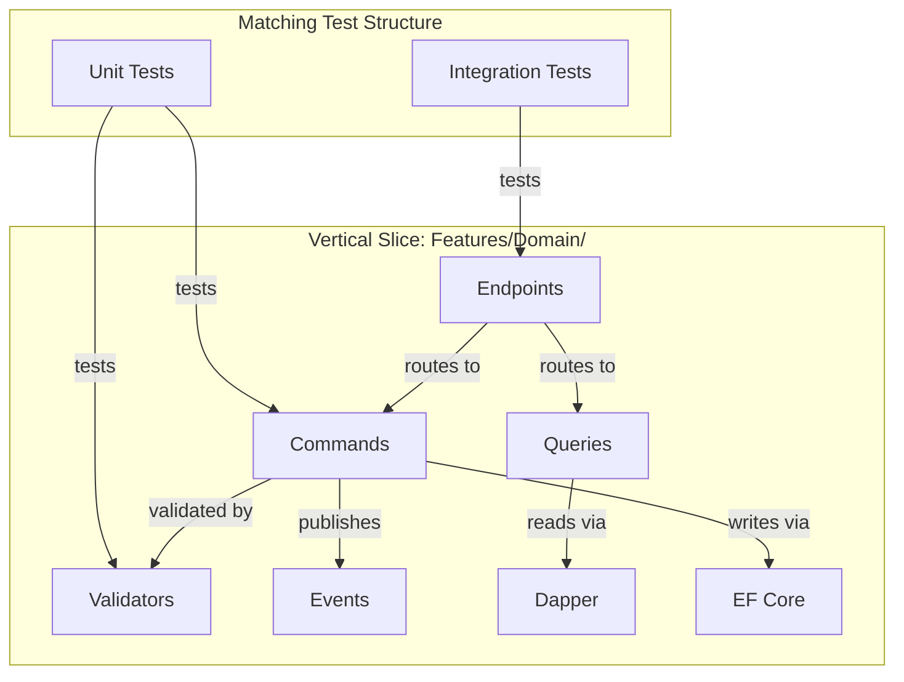
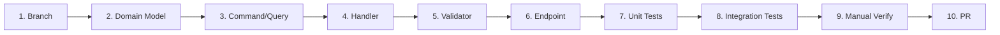
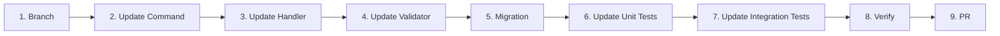
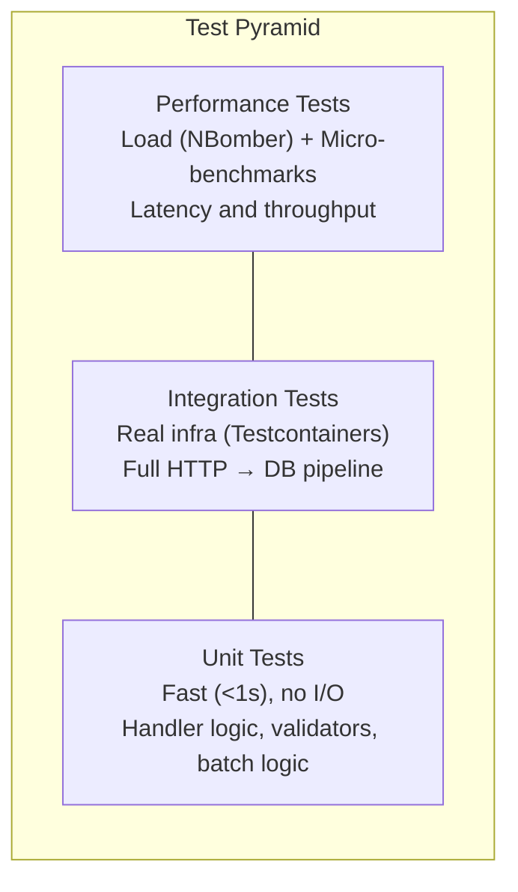
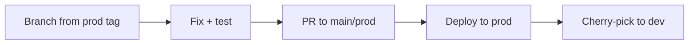
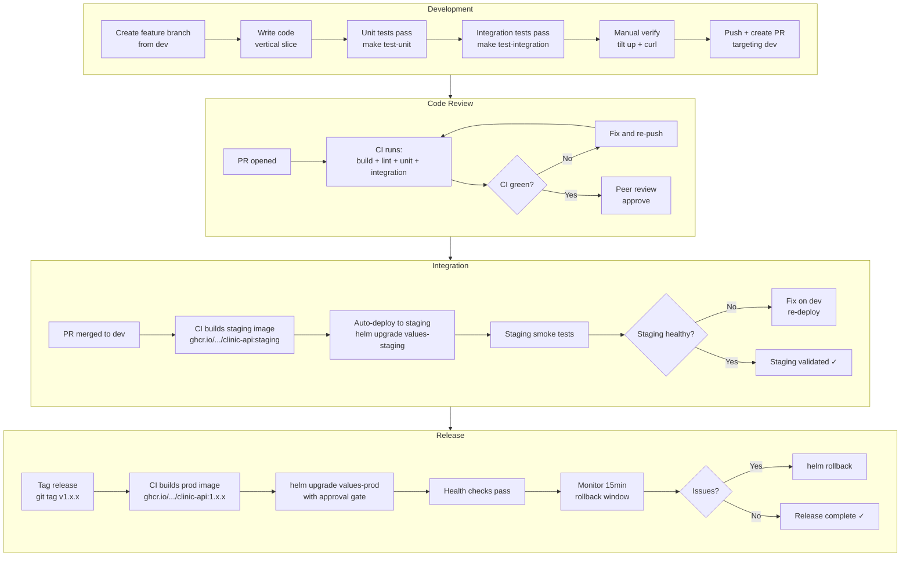

# Development Lifecycle Architecture

> Complete guide to the dev workflow, testing strategy, and release lifecycle for the Clinic API.

## Table of Contents

- [Adding a New Endpoint](#adding-a-new-endpoint)
- [Updating an Existing Endpoint](#updating-an-existing-endpoint)
- [Testing Strategy](#testing-strategy)
- [Deployment Workflows](#deployment-workflows)
- [Dev-to-Release Lifecycle](#dev-to-release-lifecycle)

---

## Vertical Slice Structure

Every feature follows the same CQRS vertical slice pattern. Understanding this structure is prerequisite to both workflows below.



```
src/ClinicApi/Features/{Domain}/
├── Commands/
│   ├── {Domain}Commands.cs      # Record types (DTOs)
│   └── {Domain}Handlers.cs      # Wolverine handlers (static Handle methods)
├── Queries/
│   ├── {Domain}Queries.cs       # Query record types + response DTOs
│   └── {Domain}QueryHandlers.cs # Dapper-based read handlers
├── Validators/
│   └── {Domain}Validators.cs    # FluentValidation rules
├── Endpoints/
│   └── {Domain}Endpoints.cs     # WolverineFx.Http route attributes
├── Events/
│   └── {Domain}EventHandlers.cs # Domain event subscribers
├── Saga/                        # (optional) Multi-step workflows
└── BatchOperations/             # (optional) Bulk insert/update/delete
```

---

## Adding a New Endpoint

This walkthrough adds a hypothetical `GET /api/patients/{id}/appointments` endpoint.



### Step 1: Create a Feature Branch

```bash
git checkout dev
git pull
git checkout -b feat/patient-appointments-query
```

Branch naming follows conventional format: `feat/<description>` or `feat/TICKET-123-description`.

### Step 2: Define the Domain Model (if new entities needed)

If the feature requires new entities or value objects, add them first.

**File:** `src/ClinicApi/Domain/Entities/Appointment.cs` (if it doesn't exist)

Skip this step if the domain model already exists (as it does for Appointments in this project).

### Step 3: Define the Query Record Types

**File:** `src/ClinicApi/Features/Patients/Queries/PatientQueries.cs`

```csharp
// Add to existing file or create new query file
public record GetPatientAppointments(Guid PatientId, int Page = 1, int PageSize = 20);

public record PatientAppointmentDto(
    Guid Id,
    Guid PatientId,
    DateTime ScheduledAt,
    string Status,
    string ProviderName,
    string Reason);

public record PatientAppointmentsResponse(
    List<PatientAppointmentDto> Appointments,
    int TotalCount,
    int Page,
    int PageSize);
```

**Why records:** Immutable, value-equality semantics, concise. Wolverine routes messages by type, so each query/command needs a unique record type.

### Step 4: Implement the Handler

**File:** `src/ClinicApi/Features/Patients/Queries/PatientQueryHandlers.cs`

```csharp
public static class GetPatientAppointmentsHandler
{
    // Wolverine convention: static Handle method, message is first param.
    // Dependencies are injected by position after the message.
    public static async Task<PatientAppointmentsResponse> Handle(
        GetPatientAppointments query,
        IDbConnectionFactory db,
        CancellationToken ct)
    {
        using var conn = db.CreateConnection();

        var sql = """
            SELECT a.Id, a.PatientId, a.ScheduledAt, a.Status, 
                   p.FullName AS ProviderName, a.Reason
            FROM Appointments a
            JOIN Providers p ON a.ProviderId = p.Id
            WHERE a.PatientId = @PatientId
            ORDER BY a.ScheduledAt DESC
            OFFSET @Offset ROWS FETCH NEXT @PageSize ROWS ONLY;

            SELECT COUNT(*) FROM Appointments WHERE PatientId = @PatientId;
            """;

        using var multi = await conn.QueryMultipleAsync(sql, new
        {
            query.PatientId,
            Offset = (query.Page - 1) * query.PageSize,
            query.PageSize
        });

        var appointments = (await multi.ReadAsync<PatientAppointmentDto>()).ToList();
        var totalCount = await multi.ReadSingleAsync<int>();

        return new PatientAppointmentsResponse(appointments, totalCount, query.Page, query.PageSize);
    }
}
```

**Why Dapper for reads:** Queries bypass EF Core's change tracker for performance. The write side uses EF Core for transactional consistency; the read side uses Dapper for speed.

### Step 5: Add Validation (if applicable)

**File:** `src/ClinicApi/Features/Patients/Validators/PatientValidators.cs`

```csharp
public class GetPatientAppointmentsValidator : AbstractValidator<GetPatientAppointments>
{
    public GetPatientAppointmentsValidator()
    {
        RuleFor(x => x.PatientId).NotEmpty();
        RuleFor(x => x.Page).GreaterThan(0);
        RuleFor(x => x.PageSize).InclusiveBetween(1, 100);
    }
}
```

**Why validate queries:** Even read operations need input validation. A page size of 1,000,000 is a denial-of-service vector.

### Step 6: Wire Up the HTTP Endpoint

**File:** `src/ClinicApi/Features/Patients/Endpoints/PatientEndpoints.cs`

```csharp
[WolverineGet("/api/patients/{patientId}/appointments")]
public static Task<PatientAppointmentsResponse> GetPatientAppointments(
    Guid patientId, int page = 1, int pageSize = 20) => throw new NotImplementedException();
```

**How it works:** The `[WolverineGet]` attribute registers the route. Wolverine matches the method parameters to a `GetPatientAppointments` query by convention (parameter names match record properties). The FluentValidation middleware runs automatically before the handler.

### Step 7: Write Unit Tests

**File:** `tests/ClinicApi.Unit/Features/Patients/PatientAppointmentQueryTests.cs`

```csharp
[Trait("Category", "Unit")]
public class GetPatientAppointmentsValidatorTests
{
    private readonly GetPatientAppointmentsValidator _validator = new();

    [Fact]
    public void Should_Fail_When_PatientIdIsEmpty()
    {
        var query = new GetPatientAppointments(Guid.Empty);
        var result = _validator.Validate(query);
        result.IsValid.Should().BeFalse();
        result.Errors.Should().Contain(e => e.PropertyName == "PatientId");
    }

    [Fact]
    public void Should_Fail_When_PageSizeExceeds100()
    {
        var query = new GetPatientAppointments(Guid.NewGuid(), PageSize: 101);
        var result = _validator.Validate(query);
        result.IsValid.Should().BeFalse();
    }

    [Fact]
    public void Should_Pass_When_ValidInput()
    {
        var query = new GetPatientAppointments(Guid.NewGuid(), Page: 1, PageSize: 20);
        var result = _validator.Validate(query);
        result.IsValid.Should().BeTrue();
    }
}
```

**Run:**
```bash
make test-unit
# or: dotnet test tests/ClinicApi.Unit --filter "Category=Unit"
```

### Step 8: Write Integration Tests

**File:** `tests/ClinicApi.Integration/Features/Patients/PatientAppointmentEndpointTests.cs`

```csharp
[Collection("Integration")]
[Trait("Category", "Integration")]
public class PatientAppointmentEndpointTests
{
    private readonly AppFixture _fixture;

    public PatientAppointmentEndpointTests(AppFixture fixture)
    {
        _fixture = fixture;
    }

    [Fact]
    public async Task GetPatientAppointments_Should_Return200_When_PatientExists()
    {
        // Arrange — seed a patient + appointment via the API
        var createResult = await _fixture.Host.Scenario(s =>
        {
            s.Post.Json(TestData.ValidCreatePatient()).ToUrl("/api/patients");
            s.StatusCodeShouldBe(HttpStatusCode.OK);
        });
        var patient = createResult.ReadAsJson<CreatePatientResponse>()!;

        // Act
        var result = await _fixture.Host.Scenario(s =>
        {
            s.Get.Url($"/api/patients/{patient.Id}/appointments");
            s.StatusCodeShouldBe(HttpStatusCode.OK);
        });

        // Assert
        var response = result.ReadAsJson<PatientAppointmentsResponse>();
        response.Should().NotBeNull();
        response!.Page.Should().Be(1);
    }

    [Fact]
    public async Task GetPatientAppointments_Should_Return400_When_InvalidPageSize()
    {
        await _fixture.Host.Scenario(s =>
        {
            s.Get.Url($"/api/patients/{Guid.NewGuid()}/appointments?pageSize=500");
            s.StatusCodeShouldBe(HttpStatusCode.BadRequest);
        });
    }
}
```

**Run:**
```bash
make test-integration
# or: dotnet test tests/ClinicApi.Integration --filter "Category=Integration"
```

Integration tests use real MSSQL and RabbitMQ via Testcontainers. They exercise the full pipeline: HTTP → Wolverine middleware → Validator → Handler → Database.

### Step 9: Manual Verification via Tilt

```bash
tilt up
# Wait for all services to be ready

# Test the endpoint
curl -k https://localhost:8443/api/patients/{id}/appointments | jq .
```

### Step 10: Create Pull Request

```bash
git add .
git commit -m "feat(patients): add patient appointments query endpoint"
git push -u origin feat/patient-appointments-query
# Create PR targeting dev
```

---

## Updating an Existing Endpoint

This walkthrough modifies the existing `PUT /api/patients/{id}` endpoint to add insurance information.



### Step 1: Create a Feature Branch

```bash
git checkout dev && git pull
git checkout -b feat/patient-insurance-field
```

### Step 2: Update the Command Record

**File:** `src/ClinicApi/Features/Patients/Commands/PatientCommands.cs`

```csharp
// Before
public record UpdatePatient(
    Guid Id,
    string FirstName,
    string LastName,
    string Email,
    string PhoneNumber,
    string Street,
    string City,
    string State,
    string ZipCode);

// After — add optional insurance fields
public record UpdatePatient(
    Guid Id,
    string FirstName,
    string LastName,
    string Email,
    string PhoneNumber,
    string Street,
    string City,
    string State,
    string ZipCode,
    string? InsuranceProvider = null,
    string? PolicyNumber = null);
```

**Key rule:** New fields on existing commands MUST be optional (nullable with defaults) to maintain backward compatibility. Existing clients that don't send the new fields continue to work.

### Step 3: Update the Handler

**File:** `src/ClinicApi/Features/Patients/Commands/PatientHandlers.cs`

```csharp
public static class UpdatePatientHandler
{
    public static async Task<PatientUpdated> Handle(
        UpdatePatient command,
        ClinicDbContext db,
        CancellationToken cancellationToken)
    {
        var patient = await db.Patients.FindAsync([command.Id], cancellationToken)
            ?? throw new InvalidOperationException($"Patient {command.Id} not found");

        patient.FirstName = command.FirstName;
        patient.LastName = command.LastName;
        patient.Email = command.Email;
        patient.Phone = new PhoneNumber(command.PhoneNumber);
        patient.Address = new Address(command.Street, command.City, command.State, command.ZipCode);
        patient.UpdatedAt = DateTime.UtcNow;

        // New: update insurance if provided
        if (command.InsuranceProvider is not null)
        {
            patient.InsuranceProvider = command.InsuranceProvider;
            patient.PolicyNumber = command.PolicyNumber;
        }

        await db.SaveChangesAsync(cancellationToken);

        return new PatientUpdated(patient.Id, patient.FirstName, patient.LastName);
    }
}
```

### Step 4: Update the Validator

**File:** `src/ClinicApi/Features/Patients/Validators/PatientValidators.cs`

```csharp
public class UpdatePatientValidator : AbstractValidator<UpdatePatient>
{
    public UpdatePatientValidator()
    {
        // ... existing rules unchanged ...

        // New: validate insurance fields only when provided
        When(x => x.InsuranceProvider is not null, () =>
        {
            RuleFor(x => x.InsuranceProvider).MaximumLength(200);
            RuleFor(x => x.PolicyNumber)
                .NotEmpty().WithMessage("Policy number required when insurance provider is set")
                .MaximumLength(50);
        });
    }
}
```

### Step 5: Add a Database Migration

```bash
# Add the migration
dotnet ef migrations add AddPatientInsurance \
  --project src/ClinicApi/ClinicApi.csproj \
  --output-dir Infrastructure/Persistence/Migrations

# Verify the generated migration SQL
dotnet ef migrations script --project src/ClinicApi/ClinicApi.csproj | tail -20

# Apply locally via Tilt
tilt trigger db-migrate
```

### Step 6: Update Unit Tests

**File:** `tests/ClinicApi.Unit/Features/Patients/PatientHandlerTests.cs`

Add new test cases for the changed behavior:

```csharp
[Fact]
public async Task Handle_Should_UpdateInsurance_When_ProviderIsSet()
{
    // Arrange
    var patient = PatientBuilders.ValidPatient();
    _db.Patients.Add(patient);
    await _db.SaveChangesAsync();

    var command = new UpdatePatient(
        patient.Id, "First", "Last", "e@mail.com", "555-0000",
        "St", "City", "ST", "12345",
        InsuranceProvider: "Blue Cross",
        PolicyNumber: "BC-12345");

    // Act
    await UpdatePatientHandler.Handle(command, _db, CancellationToken.None);

    // Assert
    var updated = await _db.Patients.FindAsync(patient.Id);
    updated!.InsuranceProvider.Should().Be("Blue Cross");
    updated.PolicyNumber.Should().Be("BC-12345");
}

[Fact]
public async Task Handle_Should_NotClearInsurance_When_FieldsOmitted()
{
    // Arrange — patient already has insurance
    var patient = PatientBuilders.ValidPatient();
    patient.InsuranceProvider = "Existing Provider";
    patient.PolicyNumber = "EX-999";
    _db.Patients.Add(patient);
    await _db.SaveChangesAsync();

    var command = new UpdatePatient(
        patient.Id, "First", "Last", "e@mail.com", "555-0000",
        "St", "City", "ST", "12345");
    // InsuranceProvider defaults to null — should NOT clear existing

    // Act
    await UpdatePatientHandler.Handle(command, _db, CancellationToken.None);

    // Assert
    var updated = await _db.Patients.FindAsync(patient.Id);
    updated!.InsuranceProvider.Should().Be("Existing Provider");
}
```

Also add validator tests:

```csharp
[Fact]
public void Should_Fail_When_InsuranceProviderSetWithoutPolicyNumber()
{
    var command = new UpdatePatient(
        Guid.NewGuid(), "F", "L", "e@m.com", "555",
        "S", "C", "ST", "12345",
        InsuranceProvider: "Aetna", PolicyNumber: null);

    var result = _validator.Validate(command);
    result.IsValid.Should().BeFalse();
    result.Errors.Should().Contain(e => e.PropertyName == "PolicyNumber");
}
```

### Step 7: Update Integration Tests

**File:** `tests/ClinicApi.Integration/Features/Patients/PatientEndpointTests.cs`

```csharp
[Fact]
public async Task UpdatePatient_Should_PersistInsurance_When_Provided()
{
    // Arrange — create a patient first
    var createCmd = TestData.ValidCreatePatient();
    var createResult = await _fixture.Host.Scenario(s =>
    {
        s.Post.Json(createCmd).ToUrl("/api/patients");
        s.StatusCodeShouldBe(HttpStatusCode.OK);
    });
    var created = createResult.ReadAsJson<CreatePatientResponse>()!;

    // Act — update with insurance
    var updateCmd = new UpdatePatient(
        created.Id, "First", "Last", "e@test.com", "555-1234",
        "St", "City", "CO", "80301",
        InsuranceProvider: "United", PolicyNumber: "UH-777");

    await _fixture.Host.Scenario(s =>
    {
        s.Put.Json(updateCmd).ToUrl($"/api/patients/{created.Id}");
        s.StatusCodeShouldBe(HttpStatusCode.OK);
    });

    // Assert — verify via GET
    var getResult = await _fixture.Host.Scenario(s =>
    {
        s.Get.Url($"/api/patients/{created.Id}");
        s.StatusCodeShouldBe(HttpStatusCode.OK);
    });
    var patient = getResult.ReadAsJson<PatientDto>();
    patient!.InsuranceProvider.Should().Be("United");
}
```

### Step 8: Verify All Tests Pass

```bash
make test-unit          # Should pass in <5s
make test-integration   # Exercises real DB with new column
```

### Step 9: Create Pull Request

```bash
git add .
git commit -m "feat(patients): add insurance fields to patient update"
git push -u origin feat/patient-insurance-field
```

---

## Testing Strategy

### Test Pyramid



### What Each Layer Tests

| Layer | Scope | Infrastructure | Speed | When to Run |
|-------|-------|---------------|-------|-------------|
| **Unit** | Handler logic, validators, domain rules | In-memory EF, NSubstitute mocks | <1s total | Every save, pre-commit |
| **Integration** | HTTP endpoints, middleware, DB queries | Real MSSQL + RabbitMQ (Testcontainers) | 30-60s | Pre-push, CI |
| **Performance** | Throughput, latency percentiles | Running API via Tilt | 2-5min | Pre-release, CI nightly |

### Unit Test Conventions

```
tests/ClinicApi.Unit/Features/{Domain}/{TestClass}.cs
```

- **Naming:** `{MethodUnderTest}_Should_{Behavior}_When_{Scenario}`
- **Structure:** Arrange → Act → Assert (one assert concept per test)
- **Isolation:** Each test gets a fresh InMemory DbContext (no shared state)
- **Mocking:** NSubstitute for interfaces that cross boundaries (IDbConnectionFactory, IBulkInsertService)
- **Data:** Use `TestBuilders` (Bogus-based factories) for consistent test data
- **Trait:** Always `[Trait("Category", "Unit")]`

### Integration Test Conventions

```
tests/ClinicApi.Integration/Features/{Domain}/{TestClass}.cs
```

- **Fixtures:** `AppFixture` provides an Alba host + Testcontainers (MSSQL, RabbitMQ)
- **Cleanup:** Respawn resets DB between test classes (not between individual tests)
- **Scope:** Test the full HTTP request lifecycle including middleware, validation, handler, DB write, event publication
- **Trait:** Always `[Trait("Category", "Integration")]` and `[Collection("Integration")]`

### When to Write Which Test

| Change Type | Unit Test? | Integration Test? | Performance Test? |
|-------------|:---:|:---:|:---:|
| New handler logic | ✓ | ✓ | — |
| New validator rules | ✓ | ✓ (400 response) | — |
| New HTTP endpoint | — | ✓ | — |
| Query optimization | — | — | ✓ (before/after) |
| Batch operation | ✓ | ✓ | ✓ (throughput) |
| Bug fix | ✓ (regression) | ✓ (if endpoint-level) | — |
| New domain event | ✓ (cascaded) | ✓ (published) | — |

---

## Deployment Workflows

### Deployment Types

```mermaid
flowchart TD
    subgraph Local["Local Dev (Tilt)"]
        T1[tilt up] --> T2[Helm chart<br/>values-dev.yaml]
        T2 --> T3[Live reload<br/>on file save]
    end

    subgraph Staging["Staging Deploy"]
        S1[PR merged to dev] --> S2[CI builds image<br/>tags: staging]
        S2 --> S3[helm upgrade<br/>values-staging.yaml]
        S3 --> S4[Post-deploy<br/>smoke tests]
    end

    subgraph Production["Production Deploy"]
        P1[Staging validated] --> P2[Tag release<br/>v1.x.x]
        P2 --> P3[helm upgrade<br/>values-prod.yaml]
        P3 --> P4[Health checks +<br/>rollback window]
    end
```



---

### Deployment 1: Local Development (Tilt)

**When:** Daily development. Every code change.

**What happens:**

```bash
make up    # or: tilt up
```

1. Tilt reads the Helm chart with `values-dev.yaml`
2. Renders k8s manifests (Namespace, Secrets, MSSQL, RabbitMQ, API, NGINX)
3. Builds Docker images locally (no push to registry)
4. Deploys to local k8s cluster (Docker Desktop / kind / k3d)
5. Establishes `live_update` watchers on `src/` directory
6. Port-forwards: API (5000), NGINX (8443/8080), MSSQL (1433), RabbitMQ (15672)

**On file save:**
- `.cs` files synced into running container → `dotnet watch` hot-reloads
- `ClinicApi.csproj` changes → full container rebuild (triggered by `fall_back_on`)
- Helm values/templates changed → Tilt re-renders and re-applies manifests

**Characteristics:**
- Single replica per service
- Ephemeral storage (no PVCs)
- Self-signed TLS
- Secrets created inline by Helm
- No Istio, no network policies, no WAF
- RBAC enabled (warn mode PSA)

**Verify:**
```bash
curl -k https://localhost:8443/api/patients | jq .
make health
```

---

### Deployment 2: Staging

**When:** Feature branch merged to `dev` and CI passes.

**Prerequisites:**
- Kubernetes cluster with Istio installed
- cert-manager with `letsencrypt-staging` ClusterIssuer
- `clinic-secrets` Secret pre-created (External Secrets or sealed-secrets)

**Steps:**

```bash
# 1. CI builds and pushes image (automated)
docker build -f docker/api/Dockerfile -t ghcr.io/your-org/clinic-api:staging .
docker push ghcr.io/your-org/clinic-api:staging

# 2. Deploy via Helm (automated by CI, or manual)
helm upgrade --install clinic-api ./helm/clinic-api \
  -f ./helm/clinic-api/values-staging.yaml \
  -n clinic-api-staging --create-namespace

# 3. Verify deployment rolled out
kubectl rollout status deployment/clinic-api -n clinic-api-staging --timeout=120s

# 4. Run smoke tests
curl https://api-staging.example.com/health
dotnet test tests/ClinicApi.Integration --filter "Category=Smoke"
```

**What gets deployed:**
- 2 replicas (API + NGINX)
- Persistent storage for MSSQL and RabbitMQ
- cert-manager TLS (Let's Encrypt staging CA)
- Network Policies (default deny, explicit allow paths)
- Istio Gateway + JWT validation (PERMISSIVE mTLS)
- Pod Security Admission (baseline, enforced)
- DB migration runs automatically (Helm post-upgrade hook)

**Rollback:**
```bash
helm rollback clinic-api -n clinic-api-staging
```

---

### Deployment 3: Production

**When:** Staging has been validated. Release tag created.

**Prerequisites:**
- Production k8s cluster with Istio (STRICT mTLS enforced)
- cert-manager with `letsencrypt-prod` ClusterIssuer
- Managed MSSQL (Azure SQL / RDS) — not in-cluster
- Managed RabbitMQ (CloudAMQP / Amazon MQ) — not in-cluster
- `clinic-secrets` from cloud KMS-backed secret manager
- On-call briefed, runbooks reviewed

**Steps:**

```bash
# 1. Tag the release
git tag v1.2.0
git push origin v1.2.0

# 2. CI builds and pushes pinned image (automated)
docker build -f docker/api/Dockerfile -t ghcr.io/your-org/clinic-api:1.2.0 .
docker push ghcr.io/your-org/clinic-api:1.2.0

# 3. Deploy via Helm (gated — requires approval)
make helm-install-prod
# This prompts: "⚠️ Deploying to PRODUCTION. Continue? [y/N]"

# Equivalent manual command:
helm upgrade --install clinic-api ./helm/clinic-api \
  -f ./helm/clinic-api/values-prod.yaml \
  -n clinic-api-prod --create-namespace

# 4. Verify rollout
kubectl rollout status deployment/clinic-api -n clinic-api-prod --timeout=180s

# 5. Post-deploy health check
curl https://api.example.com/health

# 6. Monitor for 15 minutes (rollback window)
kubectl logs -f deployment/clinic-api -n clinic-api-prod --tail=100
```

**What gets deployed:**
- 3 replicas (API + NGINX)
- LoadBalancer service with WAF + SSL annotations
- No in-cluster MSSQL or RabbitMQ (managed services)
- cert-manager TLS (Let's Encrypt production CA)
- Network Policies (default deny all)
- Istio STRICT mTLS + AuthorizationPolicies
- Pod Security Admission (restricted, enforced)
- KMS-backed secret encryption
- DB migration runs automatically (Helm post-upgrade hook)
- RabbitMQ Management UI blocked

**Rollback:**
```bash
# Immediate rollback to previous revision
helm rollback clinic-api -n clinic-api-prod

# Verify rollback
kubectl rollout status deployment/clinic-api -n clinic-api-prod
curl https://api.example.com/health
```

---

### Deployment 4: Hotfix (Emergency Production Fix)

**When:** Critical bug in production that can't wait for normal dev cycle.



**Steps:**

```bash
# 1. Branch from the production release tag
git checkout v1.2.0
git checkout -b hotfix/payment-timeout-fix

# 2. Fix the bug (minimal change)
# Edit the specific file, add a regression test

# 3. Run tests locally
make test-unit
make test-integration

# 4. Commit with hotfix type
git commit -m "hotfix(payments): increase timeout for large transactions"

# 5. Push and create PR targeting prod branch
git push -u origin hotfix/payment-timeout-fix

# 6. After merge — deploy directly to prod
docker build -f docker/api/Dockerfile -t ghcr.io/your-org/clinic-api:1.2.1 .
docker push ghcr.io/your-org/clinic-api:1.2.1

# Update values-prod.yaml image tag to 1.2.1
helm upgrade clinic-api ./helm/clinic-api \
  -f ./helm/clinic-api/values-prod.yaml \
  -n clinic-api-prod

# 7. Cherry-pick to dev to prevent regression on next release
git checkout dev
git cherry-pick <hotfix-sha>
git push
```

---

## Dev-to-Release Lifecycle

The complete lifecycle from idea to production, showing every gate and artifact.



### Phase-by-Phase Breakdown

#### Phase 1: Local Development

| Step | Command | What It Does | Gate |
|------|---------|-------------|------|
| Start environment | `make up` | Helm + Tilt deploys full stack locally | Services healthy |
| Write code | — | Implement vertical slice (command → handler → validator → endpoint) | — |
| Run unit tests | `make test-unit` | InMemory EF, no I/O, <1s | All pass |
| Run integration tests | `make test-integration` | Testcontainers (MSSQL + RabbitMQ), full pipeline | All pass |
| Format code | `make format` | `dotnet format` | No formatting issues |
| Manual verify | `curl -k https://localhost:8443/api/...` | Hit the endpoint through NGINX gateway | Expected response |

#### Phase 2: Pull Request & CI

| Step | Trigger | What Runs | Gate |
|------|---------|-----------|------|
| PR opened | `git push` + PR creation | CI pipeline fires | — |
| Build | Automatic | `dotnet build` (compile check) | Zero errors |
| Lint/Format | Automatic | `dotnet format --verify-no-changes` | Zero violations |
| Unit tests | Automatic | `dotnet test --filter Category=Unit` | All pass |
| Integration tests | Automatic | `dotnet test --filter Category=Integration` (Testcontainers in CI) | All pass |
| Helm lint | Automatic | `helm lint` all three values files | All pass |
| Code review | Manual | Peer reviews architecture, naming, test coverage | Approved |

#### Phase 3: Staging Deployment

| Step | Trigger | What Happens | Gate |
|------|---------|-------------|------|
| Merge to dev | PR approved + merged | CI triggers staging pipeline | — |
| Build image | Automatic | Docker build + push `clinic-api:staging` | Image builds |
| Deploy | Automatic | `helm upgrade` with `values-staging.yaml` | Rollout status OK |
| DB migration | Automatic | Helm post-upgrade hook runs EF migrations | Migration succeeds |
| Smoke tests | Automatic | Hit `/health`, critical endpoints | 200 responses |
| Soak period | Time-based | Monitor logs + metrics for 30 min | No error spikes |

#### Phase 4: Production Release

| Step | Trigger | What Happens | Gate |
|------|---------|-------------|------|
| Create release tag | Manual: `git tag v1.x.x` | CI triggers prod pipeline | — |
| Build prod image | Automatic | Docker build + push `clinic-api:1.x.x` (pinned) | Image builds |
| Approval gate | Manual | `make helm-install-prod` (interactive confirmation) | Human approval |
| Deploy | After approval | `helm upgrade` with `values-prod.yaml` | Rollout status OK |
| DB migration | Automatic | Helm post-upgrade hook | Migration succeeds |
| Health check | Automatic | Load balancer health probe passes | 200 on `/health` |
| Rollback window | 15 minutes | Team monitors logs, metrics, alerts | No anomalies |
| Release complete | After window | Update release notes, notify team | — |

### CI Pipeline Definition (Conceptual)

```yaml
# .github/workflows/ci.yml (conceptual)
stages:
  build:
    - dotnet restore
    - dotnet build -c Release
    - dotnet format --verify-no-changes

  test:
    - dotnet test tests/ClinicApi.Unit --filter "Category=Unit"
    - dotnet test tests/ClinicApi.Integration --filter "Category=Integration"

  helm:
    - helm lint ./helm/clinic-api -f ./helm/clinic-api/values-dev.yaml
    - helm lint ./helm/clinic-api -f ./helm/clinic-api/values-staging.yaml
    - helm lint ./helm/clinic-api -f ./helm/clinic-api/values-prod.yaml

  deploy-staging:
    when: branch == dev AND tests pass
    steps:
      - docker build + push :staging
      - helm upgrade --install -f values-staging.yaml
      - kubectl rollout status
      - curl /health

  deploy-prod:
    when: tag == v*
    steps:
      - docker build + push :{tag}
      - helm upgrade --install -f values-prod.yaml (manual approval)
      - kubectl rollout status
      - curl /health
```

### Environment Promotion Flow

```
Feature Branch → dev → staging → prod
                  │        │        │
                  │        │        └── helm upgrade values-prod.yaml (manual tag)
                  │        └── helm upgrade values-staging.yaml (auto on merge)
                  └── Tilt + values-dev.yaml (local)
```

| Promotion | Trigger | Automated? | Rollback |
|-----------|---------|:---:|----------|
| Local → dev (PR) | Developer pushes | Semi (CI runs, human reviews) | Revert commit |
| dev → staging | PR merge to dev | ✓ Fully automated | `helm rollback` |
| staging → prod | Git tag `v*` | Manual approval required | `helm rollback` |

---

## Quick Reference: Daily Workflow

```bash
# Morning: start fresh
git checkout dev && git pull
git checkout -b feat/my-feature
make up

# Development loop (repeat):
#   1. Edit code in src/ClinicApi/Features/...
#   2. Tilt live-reloads automatically
#   3. curl -k https://localhost:8443/api/... to verify
#   4. Write/run unit tests: make test-unit

# Before pushing:
make test-unit
make test-integration
make format-check

# Push and PR:
git add . && git commit -m "feat(domain): description"
git push -u origin feat/my-feature
# Create PR → CI validates → peer reviews → merge to dev → auto-deploys to staging
```
