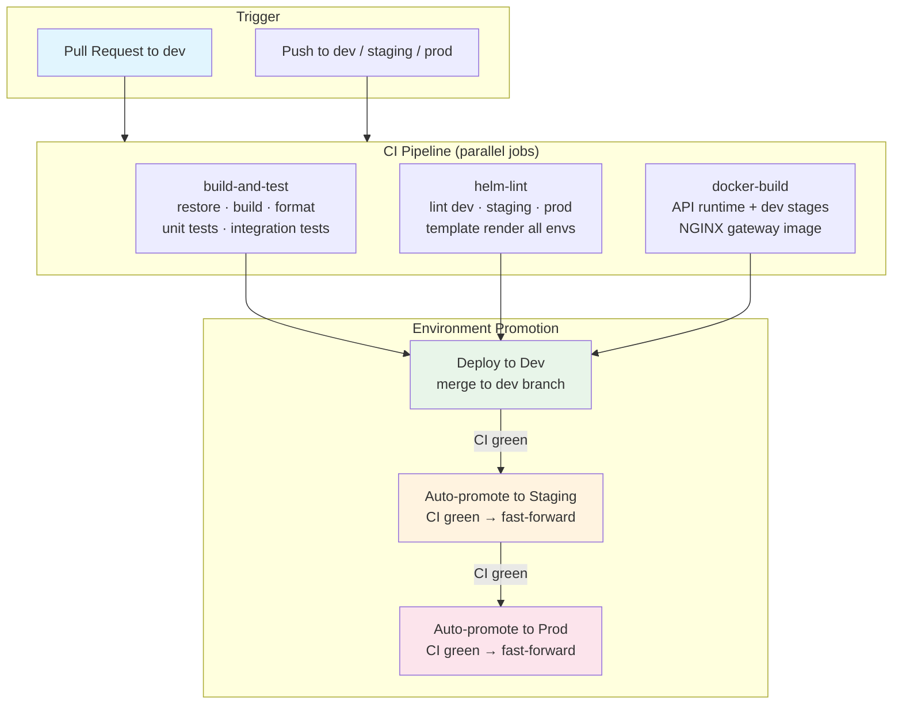
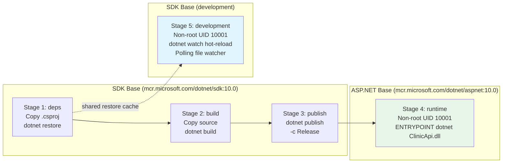
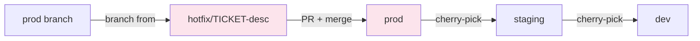
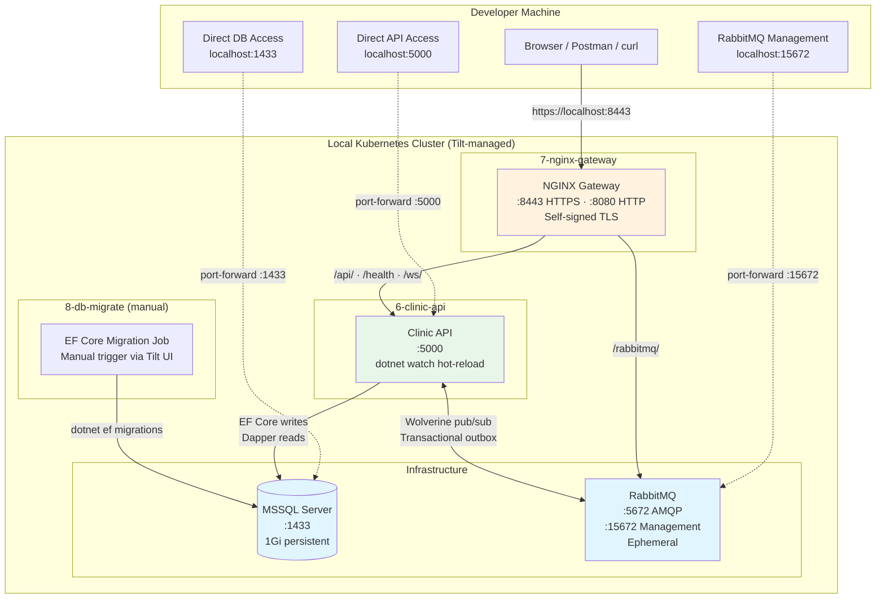
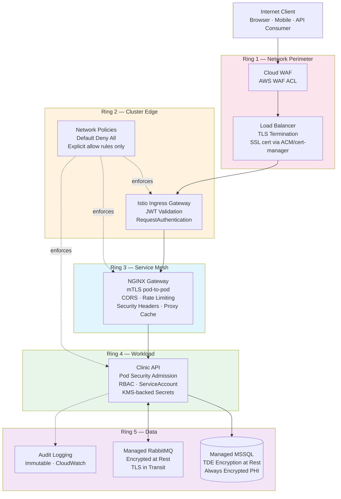
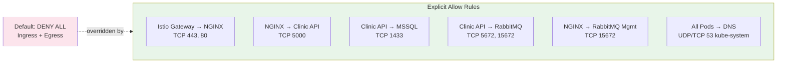

# DevOps Workflow — Deployment & Network Architecture

> CI/CD pipeline, environment promotion, network topology per environment, and operational reference for the Clinic API platform.

## Table of Contents

- [CI/CD Pipeline](#cicd-pipeline)
  - [Pipeline Overview](#pipeline-overview)
  - [CI Jobs (Parallel)](#ci-jobs-parallel)
  - [Docker Build Stages](#docker-build-stages)
  - [Promotion Flow](#promotion-flow)
  - [Hotfix Flow](#hotfix-flow)
- [Network Topology — Development (Tilt)](#network-topology--development-tilt)
- [Network Topology — Staging & Production](#network-topology--staging--production)
- [Reference Tables](#reference-tables)
  - [Environment Comparison](#environment-comparison)
  - [Ports & Rate Limits](#ports--rate-limits)
  - [Security Ring Matrix](#security-ring-matrix)
- [Deployment Commands](#deployment-commands)
  - [Local Development](#local-development)
  - [Staging](#staging)
  - [Production](#production)
  - [Rollback](#rollback)
  - [Auto-Promotion Flow](#auto-promotion-flow)
  - [Hotfix Procedure](#hotfix-procedure)

---

## CI/CD Pipeline

### Pipeline Overview

Every push to `dev`, `staging`, or `prod` (and every PR to `dev`) triggers the CI pipeline. Three jobs run in parallel, and successful completion on `dev` triggers auto-promotion through environments.



### CI Jobs (Parallel)

| Job | Steps | Service Containers | Purpose |
|-----|-------|-------------------|---------|
| `build-and-test` | restore → build → format check → unit tests → integration tests | MSSQL 2022, RabbitMQ 4 | Verify code correctness and style |
| `helm-lint` | lint (dev, staging, prod) → template render (dev, staging, prod) | None | Validate Helm chart for all environments |
| `docker-build` | Build API (runtime stage) → Build API (dev stage) → Build NGINX | None | Verify images build successfully |

### Docker Build Stages

The API Dockerfile uses a multi-stage build for cache efficiency and minimal runtime image size.



| Stage | Base Image | Output | Used By |
|-------|-----------|--------|---------|
| `deps` | sdk:10.0 | Restored packages (cached layer) | build, development |
| `build` | sdk:10.0 | Compiled assemblies | publish |
| `publish` | sdk:10.0 | Self-contained publish output | runtime |
| `runtime` | aspnet:10.0 | Production image (minimal, non-root) | Staging, Production |
| `development` | sdk:10.0 | Hot-reload dev image | Local dev via Tilt |

### Promotion Flow

```
feature branch → PR → dev → [CI green] → staging → [CI green] → prod
```

- All promotions are **fast-forward merges** (linear history)
- If fast-forward is not possible (divergence), CI alerts and blocks — manual intervention required
- Rollback: revert the offending commit on `dev`, which cascades through promotion
- Each environment runs its own CI validation before promoting to the next

### Hotfix Flow

For critical production issues that can't wait for the normal promotion cycle:



1. Branch `hotfix/*` from `prod`
2. Fix, commit with `hotfix(scope): description`
3. PR to `prod`, reviewed, CI green, merged
4. Cherry-pick to `staging` and `dev` to prevent regression on next promotion

---

## Network Topology — Development (Tilt)

Local development uses Tilt to orchestrate all services in a local Kubernetes cluster (Docker Desktop, Rancher Desktop, minikube, etc.). No Istio, no WAF, no mTLS between pods. Network policies are enforced to catch egress issues early.



**Key characteristics:**

- **TLS:** Self-signed certificate baked into NGINX Docker image at build time
- **Network Policies:** Default-deny enforced (Ring 2) — catches missing egress rules before staging
- **No Istio/WAF:** Rings 1, 3, 5 disabled. Ring 4 RBAC enabled, PSA in warn mode
- **Port Forwards:** Direct access to API (:5000), MSSQL (:1433), RabbitMQ (:5672/:15672) for debugging
- **Hot Reload:** Source synced via `live_update`; full rebuild triggered by .csproj/global.json changes
- **Migration:** Manual trigger (`tilt trigger db-migrate`) — not auto-run on startup

---

## Network Topology — Staging & Production

Staging and production use the full defense-in-depth architecture with 5 concentric security rings. Each ring independently handles a security concern, and traffic must pass through all active rings to reach the application.



**Network Policy Enforcement (Ring 2 — all environments):**



**Staging vs Production Differences:**

| Concern | Staging | Production |
|---------|---------|------------|
| mTLS Mode (Ring 3) | PERMISSIVE (allows plaintext during migration) | STRICT (no plaintext pod-to-pod) |
| MSSQL | In-cluster, 20Gi PVC | Managed service (Azure SQL / RDS) |
| RabbitMQ | In-cluster, 10Gi PVC | Managed service (CloudAMQP / Amazon MQ) |
| TLS Certificate | Let's Encrypt staging | Let's Encrypt production |
| RabbitMQ Management UI | Exposed via NGINX `/rabbitmq/` | Blocked (not proxied) |
| HPA | Disabled (fixed 2 replicas) | Enabled (3–10 replicas, 70% CPU / 80% memory) |
| PSA Level | baseline / enforce | restricted / enforce |
| Audit Retention | 1 year | 6 years (immutable, HIPAA) |
| WAF ACL | Staging ACL | Production ACL |
| CORS Origins | `staging.example.com` | `app.example.com` |

---

## Reference Tables

### Environment Comparison

| Concern | Dev | Staging | Prod |
|---------|-----|---------|------|
| **Namespace** | `clinic-api` | `clinic-api-staging` | `clinic-api-prod` |
| **API Replicas** | 1 | 2 | 3 (HPA: 3–10) |
| **NGINX Replicas** | 1 | 2 | 3 |
| **MSSQL** | In-cluster, 1Gi PVC | In-cluster, 20Gi PVC | Managed (Azure SQL / RDS) |
| **RabbitMQ** | In-cluster, ephemeral | In-cluster, 10Gi PVC | Managed (CloudAMQP / Amazon MQ) |
| **TLS** | Self-signed (baked in image) | cert-manager (LE staging) | cert-manager (LE prod) |
| **CORS Origins** | `localhost:3000`, `localhost:5173` | `staging.example.com` | `app.example.com`, `www.example.com` |
| **HPA** | Disabled | Disabled | 3–10 replicas (CPU 70%, Mem 80%) |
| **PDB** | None (1 replica) | minAvailable: 1 | minAvailable: 1 |
| **Image Source** | Built locally (Tilt) | `ghcr.io/ryanm/*` | `ghcr.io/ryanm/*` |
| **Image Tag** | `latest` (pullPolicy: Never) | `:staging` (pullPolicy: Always) | Semver `:1.0.0` (pullPolicy: IfNotPresent) |
| **Service Type** | ClusterIP + port-forwards | ClusterIP | LoadBalancer |
| **RabbitMQ Mgmt UI** | Exposed | Exposed | Blocked |

### Ports & Rate Limits

| Route / Service | Internal Port | Rate Limit Zone | Rate | Burst | Notes |
|----------------|:-------------:|:---------------:|:----:|:-----:|-------|
| `/api/*` | 5000 | `api` | 100r/s | 20 | General API traffic (dev burst: 50) |
| `/api/auth/*` | 5000 | `auth` | 10r/s | 5 | Auth endpoints (dev: 30r/s burst 10) |
| `/rabbitmq/*` | 15672 | `management` | 30r/s | 10 | Dev/staging only |
| `/ws/*` | 5000 | — | — | — | WebSocket upgrade, no rate limit |
| `/health` | 5000 | — | — | — | No rate limit, access_log off |
| MSSQL | 1433 | — | — | — | Internal only (API → DB) |
| RabbitMQ AMQP | 5672 | — | — | — | Internal only (API ↔ MQ) |
| RabbitMQ Management | 15672 | — | — | — | Internal (NGINX proxy in dev/staging) |
| NGINX HTTPS | 8443 | — | — | — | External entrypoint |
| NGINX HTTP | 8080 | — | — | — | Redirects to HTTPS |

### Security Ring Matrix

| Ring | Concern | Dev | Staging | Prod |
|:----:|---------|:---:|:-------:|:----:|
| **1** | WAF + Load Balancer | ❌ Off | ✅ WAF ACL attached | ✅ WAF + ACM SSL cert |
| **2** | Istio Gateway + JWT | ❌ No Istio | ✅ JWT validation, network policies | ✅ JWT validation, network policies |
| **2** | Network Policies | ✅ Default-deny enforced | ✅ Default-deny enforced | ✅ Default-deny enforced |
| **3** | mTLS (pod-to-pod) | ❌ Off | ⚠️ PERMISSIVE | ✅ STRICT |
| **3** | Authorization Policies | ❌ Off | ✅ Explicit source allow | ✅ Explicit source allow |
| **4** | Pod Security Admission | ⚠️ baseline / warn | ✅ baseline / enforce | ✅ restricted / enforce |
| **4** | RBAC + ServiceAccount | ✅ Enabled | ✅ Enabled | ✅ Enabled |
| **4** | KMS Secret Encryption | ❌ Off | ✅ AWS KMS | ✅ AWS KMS |
| **5** | Encryption at Rest (TDE) | ❌ Off | ✅ MSSQL TDE | ✅ MSSQL TDE |
| **5** | Audit Logging | ❌ Off | ✅ 1yr retention | ✅ 6yr immutable (HIPAA) |

---

## Deployment Commands

### Local Development

```bash
# Start all services (MSSQL, RabbitMQ, API, NGINX)
tilt up

# Start with optional telemetry stack
tilt up -- --telemetry

# Run database migration (manual trigger)
tilt trigger db-migrate

# Follow API logs
tilt logs -f 6-clinic-api

# Teardown
tilt down

# Teardown including persistent volumes
tilt down --delete-namespaces
```

### Staging

```bash
# Deploy or upgrade staging
helm upgrade --install clinic-api ./helm/clinic-api \
  -f ./helm/clinic-api/values-staging.yaml \
  -n clinic-api-staging --create-namespace

# Or use the Makefile shortcut
make helm-install-staging
```

### Production

```bash
# Deploy or upgrade production
helm upgrade --install clinic-api ./helm/clinic-api \
  -f ./helm/clinic-api/values-prod.yaml \
  -n clinic-api-prod --create-namespace

# Or use the Makefile shortcut (includes confirmation gate)
make helm-install-prod
```

### Rollback

```bash
# View release history
helm history clinic-api -n clinic-api-prod

# Rollback to a specific revision
helm rollback clinic-api <revision> -n clinic-api-prod

# Verify rollback
kubectl get pods -n clinic-api-prod -w
```

### Auto-Promotion Flow

```
1. Developer merges PR to dev
2. CI runs on dev (build-and-test + helm-lint + docker-build)
3. All green → CI creates fast-forward merge to staging
4. CI runs on staging (same 3 jobs against staging config)
5. All green → CI creates fast-forward merge to prod
6. CI runs on prod (final validation)
```

**If promotion fails:**
- Fast-forward not possible (divergence) → CI alerts, manual intervention required
- CI fails on staging/prod → promotion halts, fix required on `dev`
- Rollback: revert the offending commit on `dev`, which cascades through promotion

### Hotfix Procedure

```bash
# 1. Branch from prod
git checkout prod
git pull
git checkout -b hotfix/TICKET-123-critical-fix

# 2. Fix, commit with hotfix type
git commit -m "hotfix(payments): fix timeout on large transactions"

# 3. PR to prod → review → merge

# 4. Cherry-pick to staging and dev
git checkout staging && git cherry-pick <sha>
git checkout dev && git cherry-pick <sha>
```

If cherry-pick conflicts, create a follow-up fix on `dev` rather than forcing the cherry-pick.

---

## Related

- [README.md](../README.md) — Architecture overview and quick start
- [docs/development-lifecycle.md](development-lifecycle.md) — Adding endpoints, deployment flows
- [docs/hipaa-compliance.md](hipaa-compliance.md) — Encryption, audit, key management
- [docs/testing-architecture.md](testing-architecture.md) — Test pyramid and CI integration
- [helm/clinic-api/README.md](../helm/clinic-api/README.md) — Helm chart documentation
