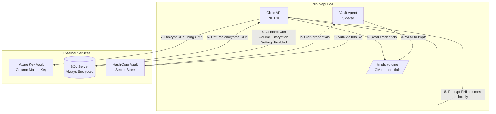

# HIPAA Compliance: Data Protection

## Encryption Architecture



## How SQL Server Always Encrypted Works

```
┌─────────────────────────────────────────────────────────────────────────┐
│ Column Master Key (CMK)                                                  │
│   Stored in: Azure Key Vault (prod), Certificate Store (dev)             │
│   Purpose: Encrypts/decrypts the Column Encryption Key                   │
│   Rotation: Rotate CMK without re-encrypting data                        │
├─────────────────────────────────────────────────────────────────────────┤
│ Column Encryption Key (CEK)                                              │
│   Stored in: SQL Server (encrypted by CMK)                               │
│   Purpose: Encrypts/decrypts actual column data                          │
│   Types: CEK_Deterministic (queryable), CEK_Randomized (max security)    │
├─────────────────────────────────────────────────────────────────────────┤
│ Encrypted Columns                                                        │
│   Driver: Microsoft.Data.SqlClient handles encrypt/decrypt transparently │
│   Config: Connection string includes "Column Encryption Setting=Enabled" │
│   Works with: EF Core AND Dapper (no handler code changes)               │
└─────────────────────────────────────────────────────────────────────────┘
```

**Key insight**: The SQL Server never has access to the CMK. Data is encrypted/decrypted by the client driver. Even a compromised database server cannot read PHI.

## Encryption Types

| Type | Security | Server-Side Operations | Use For |
|------|----------|----------------------|---------|
| **Deterministic** | High | Equality (=), JOIN, GROUP BY, UNIQUE index | Email (unique constraint) |
| **Randomized** | Maximum | None (all operations client-side) | Names, phone, address, notes, policy# |

Deterministic encryption produces the same ciphertext for the same plaintext value, enabling equality comparisons and indexing on the encrypted column.

## PHI Columns Protected

| Entity | Column | Encryption Type | Rationale |
|--------|--------|:---:|-----------|
| Patient | Email | Deterministic | Unique index required |
| Patient | FirstName | Randomized | No server-side query needed |
| Patient | LastName | Randomized | No server-side query needed |
| Patient | PhoneNumber | Randomized | No server-side query needed |
| Patient | AddressStreet | Randomized | No server-side query needed |
| Patient | InsurancePolicyNumber | Randomized | No server-side query needed |
| Appointment | Notes | Randomized | Clinical content |
| Prescription | Notes | Randomized | Clinical content |

### Not Encrypted (by design)

| Entity | Column | Reason |
|--------|--------|--------|
| Patient | DateOfBirth | Needed for age-based clinical rules, range queries |
| Patient | Status | Filtering/indexing required |
| Prescription | MedicationName | Drug interaction queries |
| Invoice | Amount | Aggregation queries (SUM, AVG) |
| Appointment | ScheduledAt | Scheduling queries, range filters |

## Vault Sidecar (Ring 5)

The Vault Agent sidecar runs alongside the API container in staging/prod:

1. **Authenticates** with HashiCorp Vault using the pod's Kubernetes service account
2. **Fetches** CMK access credentials (Azure AD client_id/secret for Key Vault)
3. **Renders** credentials to a shared tmpfs volume (`/vault/secrets/cmk-credentials.json`)
4. **Refreshes** credentials automatically before expiry (no pod restart needed)

The API's SQL Client reads these credentials via `Azure.Identity` to access the CMK in Key Vault for column decryption.

### Why Vault (not Kubernetes Secrets)?

- **Audit trail**: Every secret access is logged in Vault's audit backend
- **Dynamic credentials**: Short-lived, auto-rotated
- **Lease management**: Credentials expire and are renewed automatically
- **No etcd exposure**: Kubernetes Secrets are base64 (not encrypted) without additional KMS config

## Environment Configuration

### Development (no encryption)

```
# .env.dev — no Column Encryption Setting (PHI stored in plaintext for dev)
ConnectionStrings__ClinicDb=Server=mssql-service,1433;Database=ClinicDb;User Id=sa;Password=...;TrustServerCertificate=True;
```

Always Encrypted is **disabled in dev** — no CMK/CEK setup needed. PHI is plaintext for easy debugging. The application code is identical; only the connection string and database schema differ.

### Staging

```
# Connection string with Always Encrypted enabled
ConnectionStrings__ClinicDb=Server=mssql-service,1433;Database=ClinicDb;User Id=sa;Password=...;TrustServerCertificate=True;Column Encryption Setting=Enabled;
```

- CMK in Azure Key Vault (staging instance)
- Vault sidecar injects credentials
- Migration script (`AlwaysEncrypted_PHI_Setup.sql`) run once after initial schema creation

### Production

```
# Managed Azure SQL with Always Encrypted
ConnectionStrings__ClinicDb=Server=clinic-prod.database.windows.net;Database=ClinicDb;Authentication=Active Directory Managed Identity;Column Encryption Setting=Enabled;
```

- CMK in production Azure Key Vault (HSM-backed)
- Vault sidecar with production credentials
- Managed Identity for SQL auth (no password in connection string)
- TDE enabled on Azure SQL (additional layer, enabled by default)

## Audit Logging

PHI access is logged via `IPhiAuditLogger`:

```
PHI_AUDIT: User=system Action=Create Entity=Patient Id=abc-456 Fields=FirstName,LastName,Email,Phone,Address,DateOfBirth
PHI_AUDIT: User=system Action=Update Entity=Patient Id=abc-456 Fields=FirstName,LastName,Email,Phone,Address
PHI_AUDIT: User=system Action=Read Entity=Patient Id=abc-456 Details=GetPatientById
PHI_AUDIT: User=system Action=BulkRead Entity=Patient RecordCount=150
```

### Retention

| Environment | Retention | Destination |
|-------------|-----------|-------------|
| Dev | stdout only | — |
| Staging | 1 year | CloudWatch / Azure Monitor |
| Prod | 6 years | Immutable audit sink (per HIPAA §164.530(j)) |

## HIPAA Technical Safeguards Mapping

| HIPAA Requirement | Section | Implementation |
|-------------------|---------|----------------|
| Access Control | §164.312(a)(1) | RBAC (Ring 4), JWT validation (Ring 2) |
| Audit Controls | §164.312(b) | IPhiAuditLogger, structured logs to immutable sink |
| Integrity Controls | §164.312(c)(1) | EF Core concurrency tokens, transactional outbox |
| Transmission Security | §164.312(e)(1) | TLS 1.2+ (NGINX), mTLS (Istio/Envoy, Ring 3) |
| Encryption at Rest | §164.312(a)(2)(iv) | Always Encrypted (app), TDE (managed DB) |
| Emergency Access | §164.312(a)(2)(ii) | Break-glass procedure (documented in runbook) |
| Auto Logoff | §164.312(a)(2)(iii) | Token expiry (configured in auth provider) |

## Setup Guide

### 1. Create CMK in Azure Key Vault

```bash
az keyvault key create --vault-name clinic-keyvault --name ClinicPhiMasterKey --kty RSA --size 2048
```

### 2. Run Always Encrypted Migration

Use the provided PowerShell script (requires `SqlServer` module):

```bash
# Azure Key Vault (staging/prod)
./scripts/setup-always-encrypted.ps1 \
  -ServerInstance "mssql-service,1433" \
  -Database "ClinicDb" \
  -KeyVaultUrl "https://clinic-keyvault.vault.azure.net" \
  -KeyName "ClinicPhiMasterKey" \
  -SqlPassword "$SA_PASSWORD"

# Local development (certificate store)
./scripts/setup-always-encrypted.ps1 \
  -ServerInstance "localhost,1433" \
  -Database "ClinicDb" \
  -UseCertStore \
  -SqlPassword "YourStrong@Passw0rd"
```

Reference SQL (for manual SSMS setup): `docs/always-encrypted-setup.sql`

### 3. Configure Vault

```bash
# Enable Kubernetes auth
vault auth enable kubernetes

# Create policy for CMK access
vault policy write clinic-api - <<EOF
path "secret/data/clinic-api/cmk-credentials" {
  capabilities = ["read"]
}
EOF

# Create role bound to clinic-api service account
vault write auth/kubernetes/role/clinic-api \
  bound_service_account_names=clinic-api \
  bound_service_account_namespaces=clinic-api-staging,clinic-api-prod \
  policies=clinic-api \
  ttl=1h
```

### 4. Store CMK Credentials in Vault

```bash
vault kv put secret/clinic-api/cmk-credentials \
  tenant_id="your-azure-tenant-id" \
  client_id="your-service-principal-client-id" \
  client_secret="your-service-principal-secret"
```

### 5. Deploy with Ring 5 Enabled

The Helm chart automatically adds the Vault sidecar when `security.ring5.vault.enabled: true`.

## Production Deployment Checklist

- [ ] Azure Key Vault created with CMK (RSA 2048, HSM-backed)
- [ ] Service Principal created with Key Vault Crypto User role
- [ ] HashiCorp Vault configured with Kubernetes auth + clinic-api role
- [ ] CMK credentials stored in Vault at configured secret path
- [ ] Always Encrypted migration run on production database
- [ ] Connection string includes `Column Encryption Setting=Enabled`
- [ ] Vault sidecar confirmed running (`kubectl logs <pod> -c vault-agent`)
- [ ] Audit log sink configured with 6-year immutable retention
- [ ] PHI access logging verified end-to-end (create patient → check logs)
- [ ] TDE confirmed on managed database (Azure SQL default)
- [ ] BAA signed with cloud provider (Azure/AWS)
- [ ] Penetration test covering PHI endpoints scheduled
