# Testing Architecture

## Overview

This project implements a comprehensive testing strategy across three layers, each serving a distinct purpose in the quality assurance pipeline.

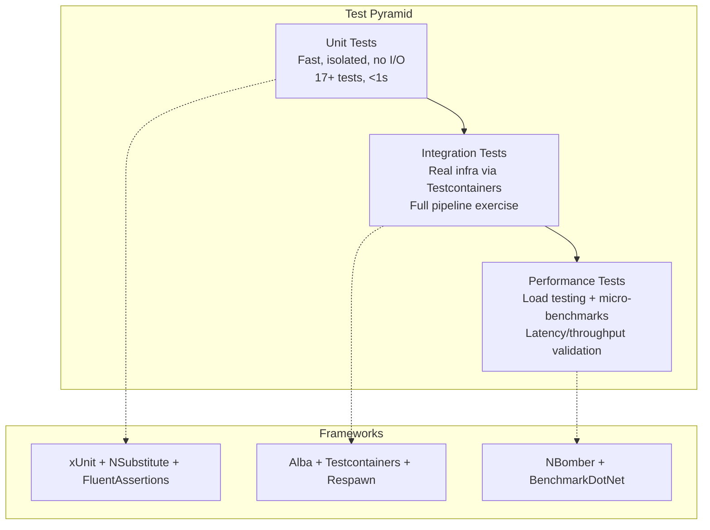

## Architecture Diagram

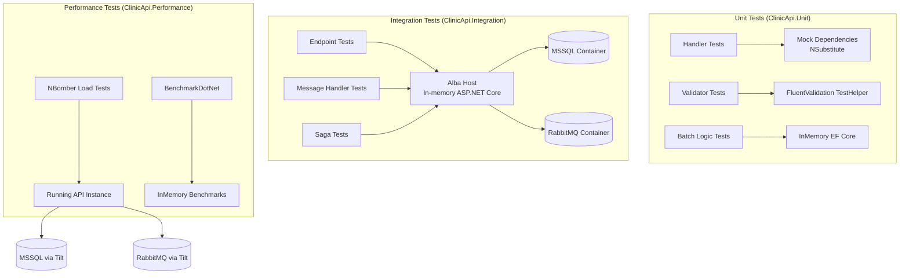

---

## Unit Tests

### Purpose
Verify individual handler logic in isolation. No network, no database, no message broker.

### Technology Stack
| Tool | Purpose |
|------|---------|
| xUnit | Test framework with collection fixtures |
| NSubstitute | Mocking framework for interfaces |
| FluentAssertions | Readable assertion library |
| Bogus | Fake data generation |
| EF Core InMemory | In-memory database for handler tests |

### Project Structure

```
tests/ClinicApi.Unit/
├── Shared/
│   └── TestBuilders.cs          # Bogus-based test data factories
├── Features/
│   ├── Patients/
│   │   ├── PatientHandlerTests.cs
│   │   ├── PatientValidatorTests.cs
│   │   └── BatchOperationTests.cs
│   ├── Billing/
│   │   └── BillingHandlerTests.cs
│   ├── Appointments/
│   │   └── SagaStepTests.cs
│   └── Prescriptions/
│       └── ScheduledMessageTests.cs
```

### Naming Convention

```
{MethodUnderTest}_Should_{ExpectedBehavior}_When_{Scenario}
```

Examples:
- `Handle_Should_CreatePatientAndReturnResponse_When_ValidCommand`
- `Validate_Should_Fail_When_EmailInvalid`
- `Handle_Should_ThrowInvalidOperation_When_PatientNotFound`

### How It Works

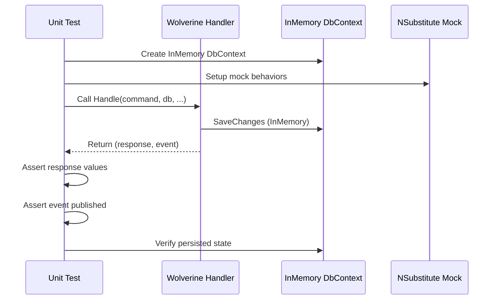

### Walkthrough: Adding a New Handler Unit Test

**Step 1:** Create the test class in the appropriate feature folder:

```csharp
// tests/ClinicApi.Unit/Features/YourFeature/YourHandlerTests.cs
using ClinicApi.Infrastructure.Persistence;
using FluentAssertions;
using Microsoft.EntityFrameworkCore;

namespace ClinicApi.Unit.Features.YourFeature;

[Trait("Category", "Unit")]
public class YourHandlerTests : IDisposable
{
    private readonly ClinicDbContext _db;

    public YourHandlerTests()
    {
        var options = new DbContextOptionsBuilder<ClinicDbContext>()
            .UseInMemoryDatabase(databaseName: Guid.NewGuid().ToString())
            .Options;
        _db = new ClinicDbContext(options);
    }

    [Fact]
    public async Task Handle_Should_DoExpectedThing_When_ValidInput()
    {
        // Arrange
        var command = /* create command */;

        // Act
        var result = await YourHandler.Handle(command, _db, CancellationToken.None);

        // Assert
        result.Should().NotBeNull();
        // ... more assertions
    }

    public void Dispose() => _db.Dispose();
}
```

**Step 2:** Add `[Trait("Category", "Unit")]` to the class.

**Step 3:** Run: `dotnet test tests/ClinicApi.Unit --filter "Category=Unit"`

### Walkthrough: Adding a Validator Test

```csharp
[Trait("Category", "Unit")]
public class YourValidatorTests
{
    private readonly YourCommandValidator _validator = new();

    [Fact]
    public void Validate_Should_Pass_When_AllFieldsValid()
    {
        var command = /* valid command */;
        var result = _validator.TestValidate(command);
        result.ShouldNotHaveAnyValidationErrors();
    }

    [Theory]
    [InlineData("")]
    [InlineData(null)]
    public void Validate_Should_Fail_When_NameInvalid(string? name)
    {
        var command = /* command with invalid name */;
        var result = _validator.TestValidate(command);
        result.ShouldHaveValidationErrorFor(x => x.Name);
    }
}
```

---

## Integration Tests

### Purpose
Verify the full application pipeline with real infrastructure. Tests exercise HTTP endpoints through Wolverine's middleware pipeline, message handlers, saga workflows, and database operations against real MSSQL and RabbitMQ instances.

### Technology Stack
| Tool | Purpose |
|------|---------|
| Alba | In-memory HTTP testing for ASP.NET Core (JasperFx) |
| Testcontainers | Docker containers for MSSQL and RabbitMQ |
| Respawn | Database reset between tests (clean state) |
| xUnit Collection Fixtures | Shared container lifecycle |

### Container Lifecycle

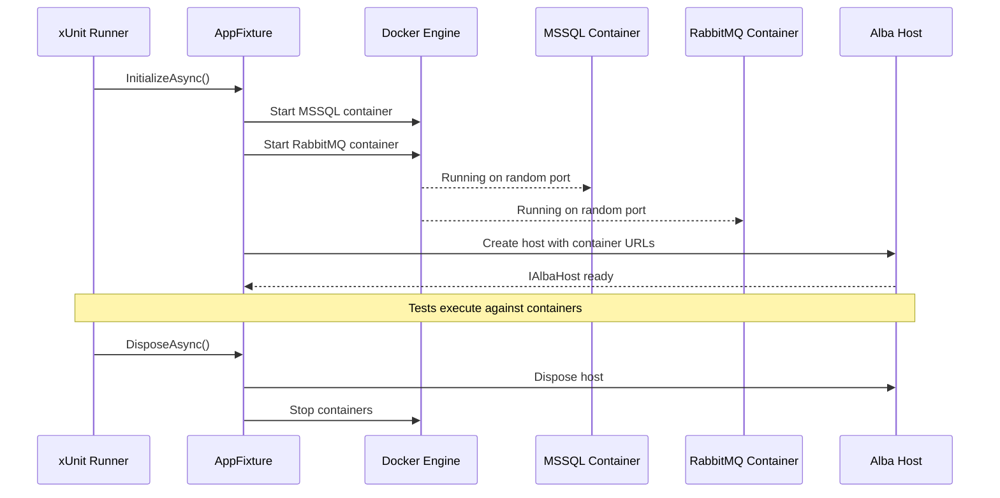

### Alba Request Flow

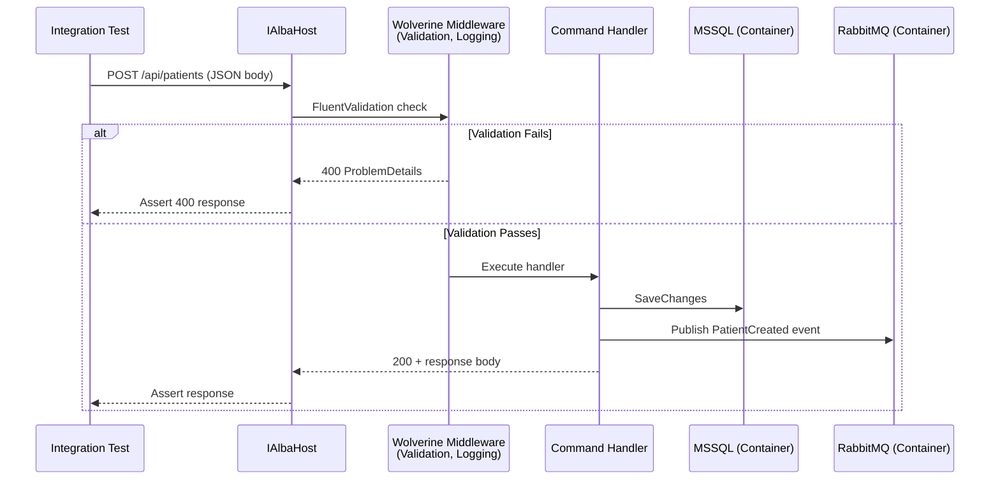

### Wolverine TrackedSession Flow

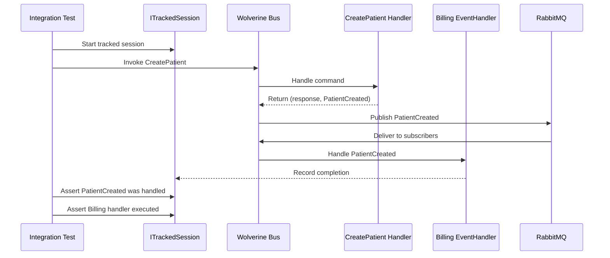

### Walkthrough: Adding a New Endpoint Integration Test

**Step 1:** Create test class in the feature folder:

```csharp
// tests/ClinicApi.Integration/Features/YourFeature/YourEndpointTests.cs
using System.Net;
using Alba;
using ClinicApi.Integration.Fixtures;
using FluentAssertions;

namespace ClinicApi.Integration.Features.YourFeature;

[Collection("Integration")]
[Trait("Category", "Integration")]
public class YourEndpointTests
{
    private readonly AppFixture _fixture;

    public YourEndpointTests(AppFixture fixture)
    {
        _fixture = fixture;
    }

    [Fact]
    public async Task YourEndpoint_Should_Return200_When_ValidRequest()
    {
        var command = new YourCommand(/* valid data */);

        var result = await _fixture.Host.Scenario(s =>
        {
            s.Post.Json(command).ToUrl("/api/your-endpoint");
            s.StatusCodeShouldBe(HttpStatusCode.OK);
        });

        var response = result.ReadAsJson<YourResponse>();
        response.Should().NotBeNull();
        response!.Id.Should().NotBeEmpty();
    }
}
```

**Step 2:** Ensure `[Collection("Integration")]` attribute is present (shares the container fixture).

**Step 3:** Run: `dotnet test tests/ClinicApi.Integration --filter "Category=Integration"`

### Walkthrough: Adding a Message Handler Integration Test

```csharp
[Collection("Integration")]
[Trait("Category", "Integration")]
public class EventHandlerIntegrationTests
{
    private readonly AppFixture _fixture;

    public EventHandlerIntegrationTests(AppFixture fixture)
    {
        _fixture = fixture;
    }

    [Fact]
    public async Task PatientCreated_Should_TriggerBillingHandler()
    {
        // Use Wolverine's tracked session to verify cascading messages
        var host = _fixture.Host;

        // Invoke through HTTP (triggers full pipeline)
        await host.Scenario(s =>
        {
            s.Post.Json(new CreatePatient(/* ... */)).ToUrl("/api/patients");
            s.StatusCodeShouldBe(HttpStatusCode.OK);
        });

        // The PatientCreated event should cascade to Billing handler
        // Verification via database state or TrackedSession
    }
}
```

---

## Performance Tests

### Purpose
Validate API throughput and latency under load (NBomber) and measure hot-path execution time (BenchmarkDotNet).

### Technology Stack
| Tool | Purpose |
|------|---------|
| NBomber | HTTP load testing with scenarios and reports |
| BenchmarkDotNet | Micro-benchmarks for code-level performance |

### NBomber Scenario Composition

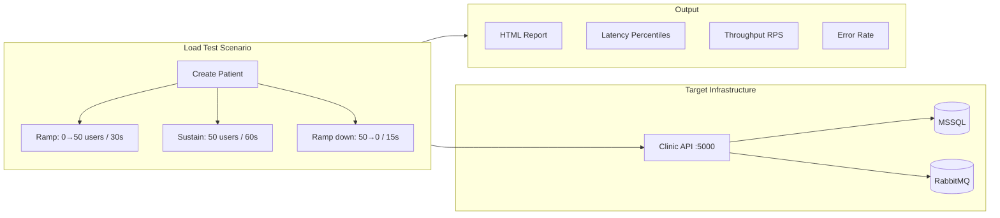

### BenchmarkDotNet Comparison Pattern

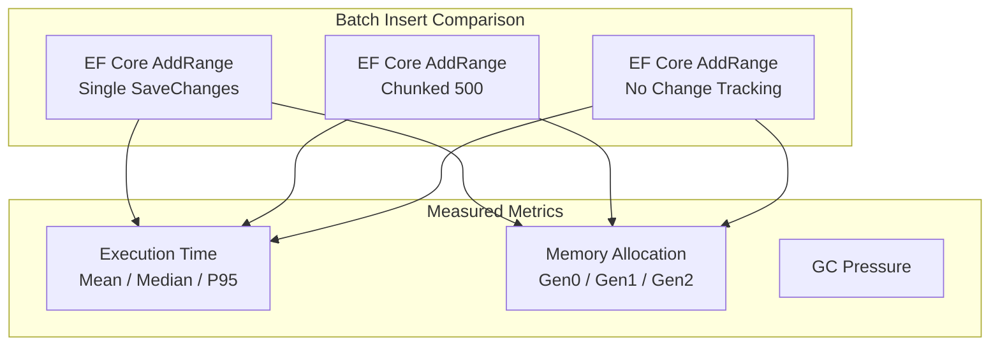

### Walkthrough: Adding a New NBomber Load Scenario

**Step 1:** Create scenario in `tests/ClinicApi.Performance/LoadTests/`:

```csharp
[Trait("Category", "Performance")]
public class YourLoadTests
{
    [Fact(Skip = "Requires running API via 'tilt up'")]
    public void YourScenario_Should_MeetPerformanceBaseline()
    {
        using var httpClient = new HttpClient { BaseAddress = new Uri("http://localhost:5000") };

        var scenario = Scenario.Create("your_scenario", async context =>
        {
            var request = Http.CreateRequest("GET", "http://localhost:5000/api/your-endpoint");
            return await Http.Send(httpClient, request);
        })
        .WithLoadSimulations(
            Simulation.Inject(rate: 100, interval: TimeSpan.FromSeconds(1), during: TimeSpan.FromMinutes(2))
        );

        NBomberRunner
            .RegisterScenarios(scenario)
            .WithReportFolder("nbomber_reports")
            .Run();
    }
}
```

**Step 2:** Run with a live API: `tilt up` then `make test-performance`

**Step 3:** Check report in `nbomber_reports/` directory.

### Walkthrough: Adding a BenchmarkDotNet Micro-Benchmark

```csharp
[MemoryDiagnoser]
[SimpleJob(warmupCount: 3, iterationCount: 10)]
public class YourBenchmarks
{
    [Params(100, 500, 1000)]
    public int DataSize { get; set; }

    [GlobalSetup]
    public void Setup() { /* prepare test data */ }

    [Benchmark(Baseline = true)]
    public async Task Approach_A() { /* implementation A */ }

    [Benchmark]
    public async Task Approach_B() { /* implementation B */ }
}
```

Run: `dotnet run --project tests/ClinicApi.Performance -c Release -- --filter "*YourBenchmarks*"`

---

## Batch Operation Testing

### Testing Bulk Inserts

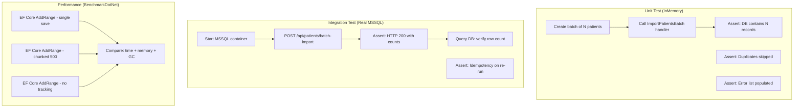

### Testing Batch Message Handlers

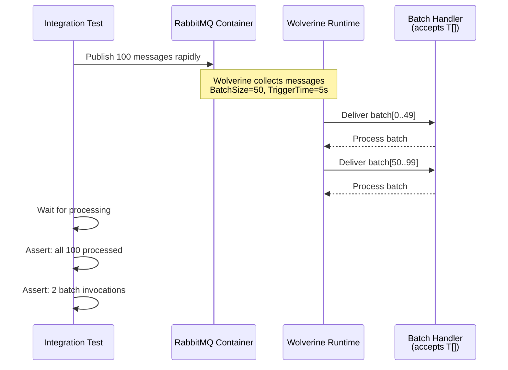

---

## Testing Decision Matrix

| Scenario | Test Type | Why |
|----------|-----------|-----|
| Handler returns correct response | Unit | Fast, no I/O needed |
| Validator rejects invalid input | Unit | Pure logic, no dependencies |
| Saga step transitions state correctly | Unit | Isolated step logic |
| HTTP endpoint returns correct status code | Integration | Full middleware pipeline |
| Event cascades to downstream handler | Integration | Requires message broker |
| Batch insert creates correct row count | Integration | Requires real database |
| ExecuteUpdate modifies correct records | Integration | InMemory doesn't support ExecuteUpdate |
| API handles 100 concurrent users | Performance (NBomber) | Load/stress testing |
| EF Core AddRange vs SqlBulkCopy speed | Performance (Benchmark) | Comparative measurement |
| Handler execution time per invocation | Performance (Benchmark) | Micro-benchmark |

---

## CI Pipeline Integration

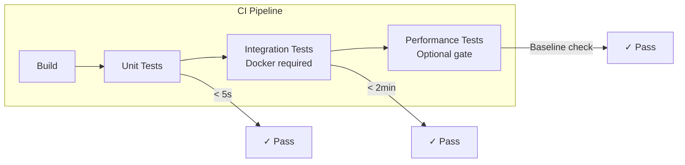

### CI Commands

```bash
# Step 1: Build
dotnet build

# Step 2: Unit tests (always run, fast)
dotnet test tests/ClinicApi.Unit --filter "Category=Unit"

# Step 3: Integration tests (requires Docker daemon)
dotnet test tests/ClinicApi.Integration --filter "Category=Integration"

# Step 4: Performance tests (optional, requires running API)
# Typically run on dedicated performance environment
dotnet test tests/ClinicApi.Performance --filter "Category=Performance"
```

---

## Troubleshooting

### Common Issues

| Issue | Cause | Fix |
|-------|-------|-----|
| `UseInMemoryDatabase` not found | Missing package | `dotnet add package Microsoft.EntityFrameworkCore.InMemory` |
| Integration tests timeout | Docker not running | Start Docker Desktop / daemon |
| `ExecuteUpdate` fails in unit tests | InMemory doesn't support it | Use integration tests for ExecuteUpdate/Delete |
| NBomber reports connection refused | API not running | Run `tilt up` before performance tests |
| Container port conflicts | Previous containers still running | `docker ps` and stop conflicting containers |
| Testcontainers permission denied | Docker socket access | Add user to `docker` group |

### Debugging Integration Tests

1. Run with verbose logging:
   ```bash
   dotnet test tests/ClinicApi.Integration -v detailed
   ```

2. Check container logs:
   ```bash
   docker logs $(docker ps -q --filter "ancestor=mcr.microsoft.com/mssql/server")
   ```

3. Connect to test database:
   ```bash
   # Find the random port Testcontainers assigned
   docker ps --format "{{.Ports}}" --filter "ancestor=mcr.microsoft.com/mssql/server"
   ```

---

## File Quick Reference

| File | Purpose |
|------|---------|
| `tests/ClinicApi.Unit/Shared/TestBuilders.cs` | Bogus-based fake data factories |
| `tests/ClinicApi.Integration/Fixtures/AppFixture.cs` | Testcontainers + Alba shared fixture |
| `tests/ClinicApi.Performance/LoadTests/*.cs` | NBomber HTTP load scenarios |
| `tests/ClinicApi.Performance/Benchmarks/*.cs` | BenchmarkDotNet micro-benchmarks |
| `Makefile` | `make test`, `make test-unit`, `make test-integration`, `make test-performance` |
